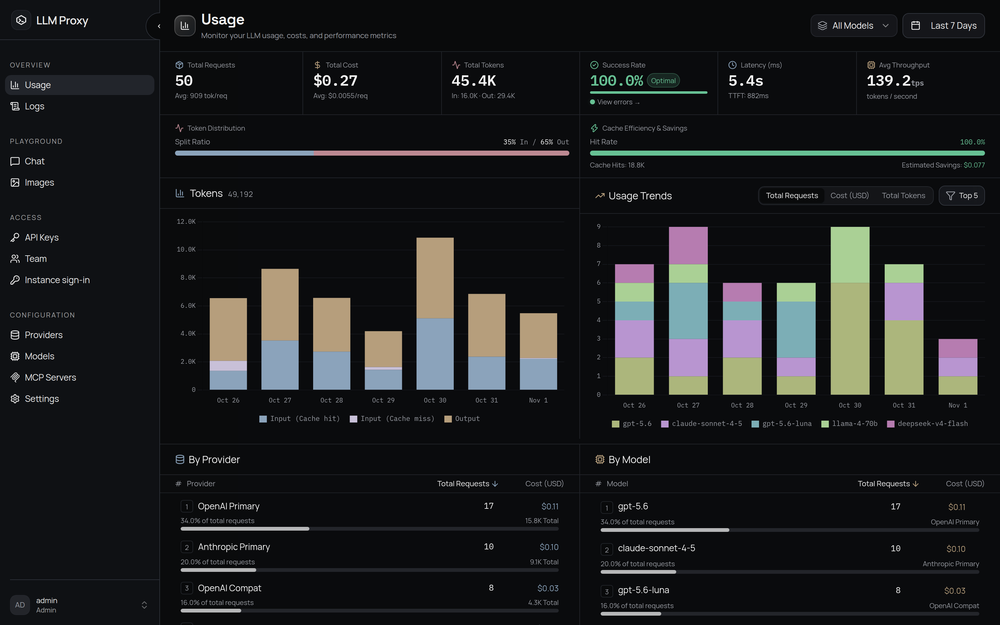
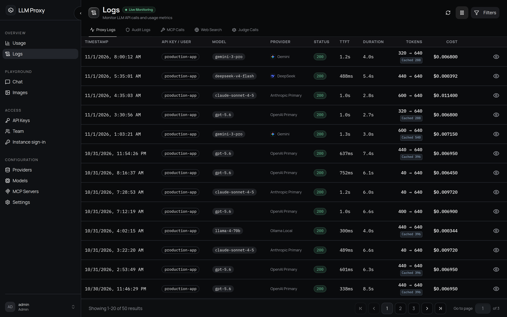
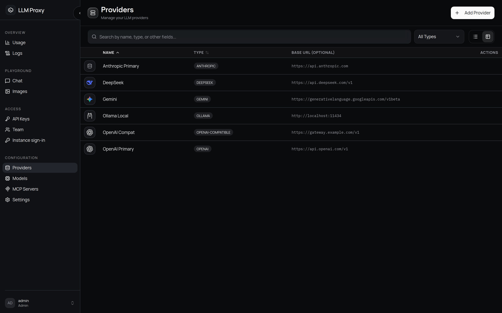
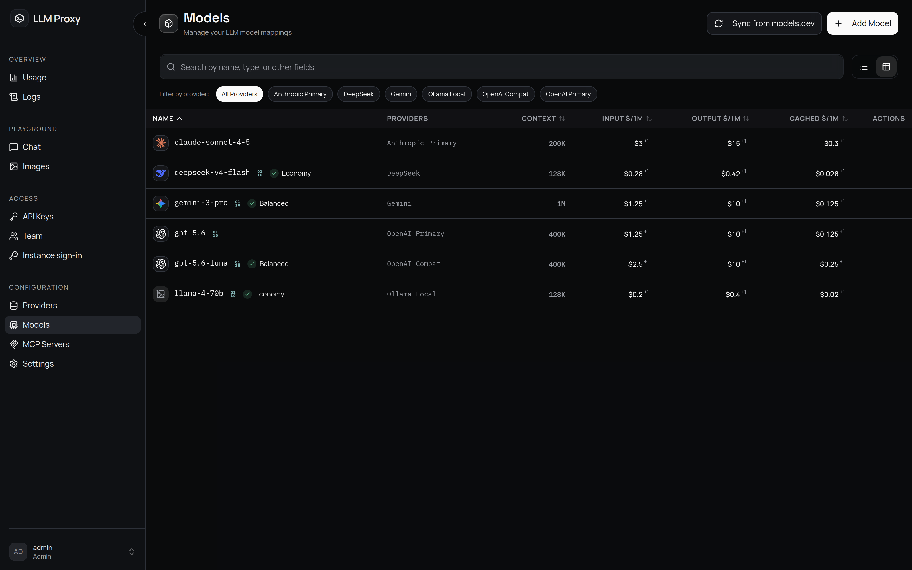
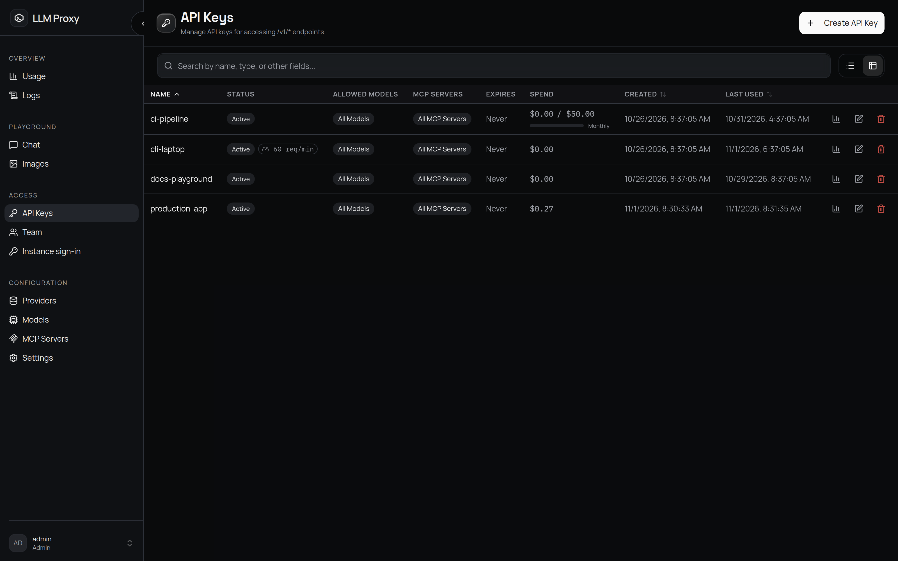
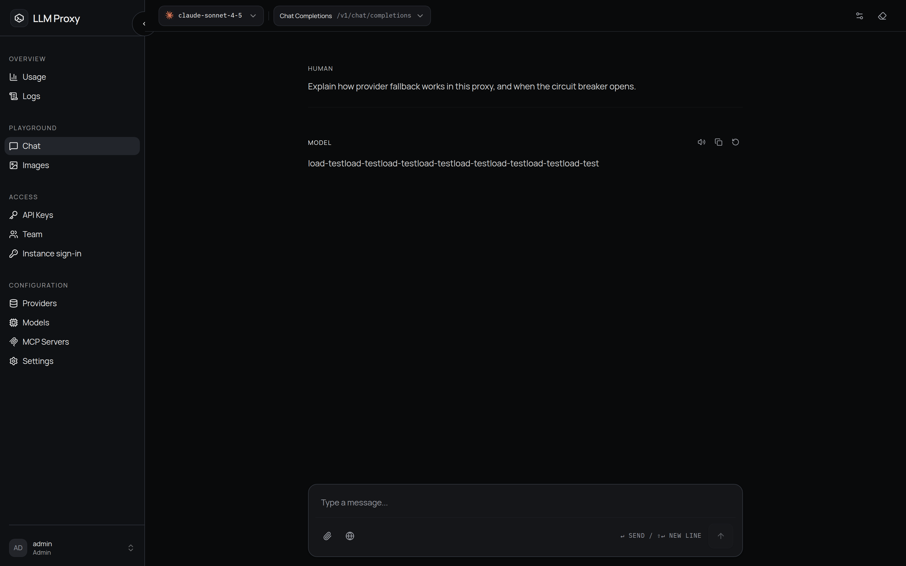
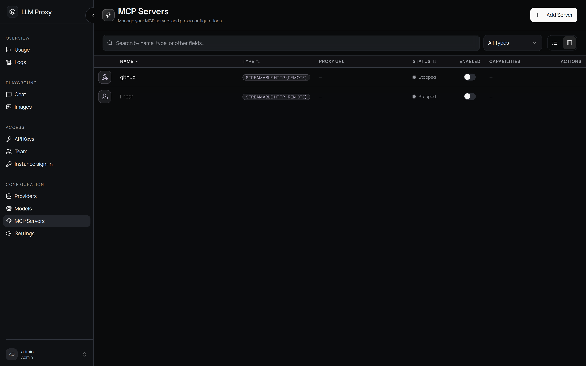

# LLM Proxy

A self-hosted gateway for LLM APIs. Clients send OpenAI, Anthropic, or Cohere-compatible requests; the proxy forwards each one to a configured provider and translates the response back.

[](https://github.com/zwldarren/llm-proxy/actions/workflows/ci.yml)
[](https://github.com/zwldarren/llm-proxy/releases)
[](https://python.org)
[](https://github.com/zwldarren/llm-proxy/pkgs/container/llm-proxy)
[](https://zwldarren.github.io/llm-proxy/)
[](LICENSE)



LLM Proxy sits between your application and the model providers you pay for. Point an OpenAI or Anthropic SDK at the proxy, or a Cohere SDK at the rerank endpoint, and the proxy sends the request to whichever upstream serves the requested model. Supported providers include OpenAI, Anthropic, Gemini, OpenRouter, Ollama, vLLM, SGLang, and any OpenAI-compatible endpoint. Fallback, per-key budgets, request logs, and the admin console are built in. Configuration lives in the database and is applied without a restart.

## Contents

- [How it works](#how-it-works)
- [Why LLM Proxy](#why-llm-proxy)
- [What it supports](#what-it-supports)
- [Quick start](#quick-start)
- [Use it from code](#use-it-from-code)
- [Configuration](#configuration)
- [Operations](#operations)
- [Documentation](#documentation)
- [More screenshots](#more-screenshots)
- [Development](#development)
- [Contributing](#contributing)
- [Security](#security)
- [License](#license)

## How it works

```text
Client                     LLM Proxy                                  Upstream
OpenAI / Anthropic /  ──▶  parse to InternalRequest                   provider API
Cohere rerank wire         route: mapping, allowlists, budgets,   ──▶  (built-in
                           retries, fallback, circuit breaker           adapters)
                      ◀──  translate back to the client's protocol
```

The proxy parses each client request into an internal request model. A protocol serializer handles the client side, and a provider serializer builds the upstream body. A request can arrive as OpenAI Chat Completions and leave as Anthropic Messages, or be forwarded unchanged when both sides use the same protocol.

## Why LLM Proxy

- Clients keep their existing SDK and change only the base URL. Model names are defined in the proxy, so one name can point to any upstream model.
- Failed requests retry on the same provider and then fall back to the next mapping. A circuit breaker skips providers that keep failing.
- Virtual models `auto`, `fast`, and `best` classify each request in-process, without an external model.
- Pricing covers input, output, cached, audio, and image tokens. API keys and user accounts can carry USD budgets.
- Providers, models, pricing, keys, MCP servers, tracing, and policy are edited in the console and reloaded on change.

If you want an in-process library rather than a gateway, or a managed service where you never run infrastructure, this project is not the right fit.

## What it supports

| Client protocol | Endpoint |
| --- | --- |
| OpenAI Chat Completions | `POST /v1/chat/completions` |
| OpenAI Responses | `POST /v1/responses` (+ retrieve, delete, cancel, input items, compact, SSE and WebSocket) |
| Anthropic Messages | `POST /v1/messages` (+ `POST /v1/messages/count_tokens`) |
| Cohere-compatible rerank | `POST /v1/rerank` (alias `POST /v2/rerank`) |
| Evaluation | `POST /v1/systemone` · `POST /v1/decisions` |
| OpenAI-compatible utilities | `/v1/embeddings` · `/v1/images/generations` · `/v1/images/edits` · `/v1/audio/speech` · `/v1/audio/transcriptions` · `/v1/audio/translations` · `/v1/models` |

Built-in adapters cover OpenAI, Anthropic, Gemini, DeepSeek, xAI, Qwen, Moonshot, MiniMax, Z.ai, Mistral, Cohere, OpenRouter, Chutes, NanoGPT, Ollama, vLLM, SGLang, the OpenCode Zen/Go lanes, the System One (`typesafe`) evaluation provider, and a generic `openai-compatible` type. Native passthrough forwards Anthropic or Responses requests verbatim when the upstream speaks the same protocol. See the [capability matrix](https://zwldarren.github.io/llm-proxy/api/endpoints.html#capability-matrix) for which provider serves which modality.

The proxy also hosts MCP servers at `/servers/<name>/mcp` with the same keys, budgets, and logs as model traffic, and intercepts `web_search` tool calls through your own SearXNG or Ollama backend.

## Quick start

### Prerequisites

| Path | Needs |
| --- | --- |
| Docker Compose (recommended) | Docker Engine 24+ with Compose v2 |
| From source | Python **3.15+**, [uv](https://docs.astral.sh/uv/), [bun](https://bun.sh) (to build the admin UI) |

### Docker Compose

```bash
git clone https://github.com/zwldarren/llm-proxy.git
cd llm-proxy
docker compose up -d
```

This starts the proxy with PostgreSQL 18 and Redis 8. The database password defaults to `llmproxy`. Set your own in `.env` before the first start if the stack is reachable by anyone else; Postgres applies the password when it initializes the volume.

```bash
echo "POSTGRES_PASSWORD=$(openssl rand -hex 16)" > .env
docker compose up -d
```

Confirm the proxy is ready before opening the console:

```bash
curl -fsS http://localhost:8080/api/health/ready
# {"status":"ready","timestamp":"..."}
```

### From source

```bash
uv sync
uv run llm-proxy --build-frontend
```

The server listens on `http://localhost:8080` (change it with `--host`/`--port`). SQLite is used by default; set `DATABASE_URL` for PostgreSQL. All CLI flags are listed in the [installation guide](https://zwldarren.github.io/llm-proxy/getting-started/installation.html#server-options).

### First run

Open **http://localhost:8080**. The setup screen creates the first admin account. After that, add a provider, check the model mappings and pricing, and create an API key. Clients authenticate with that key; console logins do not work on `/v1/*`.

- [First setup](https://zwldarren.github.io/llm-proxy/getting-started/first-setup.html)
- [Providers](https://zwldarren.github.io/llm-proxy/admin/providers.html)
- [Models & pricing](https://zwldarren.github.io/llm-proxy/admin/models.html)

## Use it from code

Create a key under **Access → API Keys**, then point any SDK at the proxy:

```bash
curl http://localhost:8080/v1/chat/completions \
  -H "Authorization: Bearer sk-your-proxy-key" \
  -H "Content-Type: application/json" \
  -d '{"model": "auto", "messages": [{"role": "user", "content": "Hello!"}]}'
```

```python
# OpenAI SDK; only base_url changes
from openai import OpenAI

client = OpenAI(base_url="http://localhost:8080/v1", api_key="sk-your-proxy-key")
client.chat.completions.create(model="gpt-5.6-luna", messages=[...])
```

```python
# Anthropic SDK; same key, same gateway
from anthropic import Anthropic

client = Anthropic(base_url="http://localhost:8080", api_key="sk-your-proxy-key")
client.messages.create(model="deepseek-v4-flash", max_tokens=1024, messages=[...])
```

`model="auto"` (or `fast` / `best`) enables smart routing. A concrete model name goes straight to its configured provider, with fallback.

Claude Code, OpenAI Codex, OpenCode, Pi, OMP, and Hermes Agent work through the proxy with a base URL and an API key. Copy-paste configs are in [Connect an AI Agent](https://zwldarren.github.io/llm-proxy/getting-started/connect-an-agent.html).

## Configuration

Configuration has two channels.

The admin console stores providers, models, pricing, logging, rate limits, CORS, web search, smart routing, resilience, tracing, MCP security, and console sign-in policy in the database. Changes apply immediately.

Environment variables are read once at startup. They cover database and Redis connections, the HTTP client pool, worker count, `LOG_LEVEL`, `TRUSTED_PROXIES`, batch-writer tuning, and optional `JWT_SECRET` / `ENCRYPTION_KEY` overrides. When unset, both secrets are generated and stored in the database on first run.

The complete variable list is in the [environment reference](https://zwldarren.github.io/llm-proxy/reference/environment.html). `.env.example` lists the same keys with defaults.

## Operations

Rate-limit windows, account lockout, and circuit-breaker state are per-process. Auto worker selection scales past one process only on PostgreSQL, and the shipped Compose file enables Redis so limits are shared. With Redis rate limiting off, set `UVICORN_WORKERS=1`.

HSTS is on by default. Set `TRUSTED_PROXIES` to your actual proxy networks; it replaces the default RFC1918 ranges rather than extending them.

The database holds the JWT secret and the encrypted provider keys. Losing it means losing both. Migrations run on startup.

See [Reverse proxy & TLS](https://zwldarren.github.io/llm-proxy/deployment/reverse-proxy.html) and [Upgrades & backups](https://zwldarren.github.io/llm-proxy/deployment/upgrades.html).

## Documentation

**Full documentation:** <https://zwldarren.github.io/llm-proxy/>. Available in English and Simplified Chinese (switch languages in the site header). The console itself ships in English and 中文.

| Section | What is inside |
| --- | --- |
| [Getting started](https://zwldarren.github.io/llm-proxy/getting-started/installation.html) | Install, first-run setup, connect a client or coding agent, core concepts |
| [Deployment](https://zwldarren.github.io/llm-proxy/deployment/docker.html) | Docker Compose, PostgreSQL & Redis, reverse proxy, upgrades, troubleshooting |
| [Admin console](https://zwldarren.github.io/llm-proxy/admin/overview.html) | Providers, models & pricing, API keys, users, MCP, every server setting |
| [API reference](https://zwldarren.github.io/llm-proxy/api/) | Auth, endpoints, streaming, tools & web search, OpenAPI, errors |
| [Guides](https://zwldarren.github.io/llm-proxy/guides/cost-control.html) | Cost control, monitoring & alerting, security hardening |
| [Reference](https://zwldarren.github.io/llm-proxy/reference/environment.html) | Environment variables, FAQ |

Release history: [CHANGELOG.md](CHANGELOG.md).

## More screenshots

| | |
| --- | --- |
|  |  |
|  |  |
|  |  |

## Development

```bash
uv sync
uv run llm-proxy-dev        # backend :9911 + Vite :5173 (requires bun)
```

Verification, in this order:

```bash
uv run ruff check --fix && uv run ruff format && uv run ty check && uv run pytest
```

Documentation site:

```bash
cd docs && bun install
bun run docs:dev            # http://localhost:9912/llm-proxy/
bun run docs:build
```

The repo ships a `.pre-commit-config.yaml` that runs the same ruff and ty checks before each commit (`pre-commit install`). Architecture notes and ADRs live in [`docs/adr/`](docs/adr/); the public site excludes them.

Stack: Python 3.15, FastAPI, SQLAlchemy + Alembic, Redis (optional), httpx2. Vue 3, Vite, TypeScript, Tailwind CSS v4, shadcn-vue, Pinia, vue-i18n.

## Contributing

Issues and pull requests are welcome. Start with an issue describing the behavior you want to change, then follow the development and verification steps above. Keep docs in sync with behavior: user docs live in `docs/`, and every runtime default you touch should also appear in `docs/reference/environment.md` or the matching admin page.

See [CONTRIBUTING.md](CONTRIBUTING.md) for the full workflow.

## Security

Do not open a public issue for a vulnerability. Report it privately through [GitHub Security Advisories](https://github.com/zwldarren/llm-proxy/security/advisories/new); see [SECURITY.md](SECURITY.md) for scope and response expectations.

## License

MIT. See [LICENSE](LICENSE).
