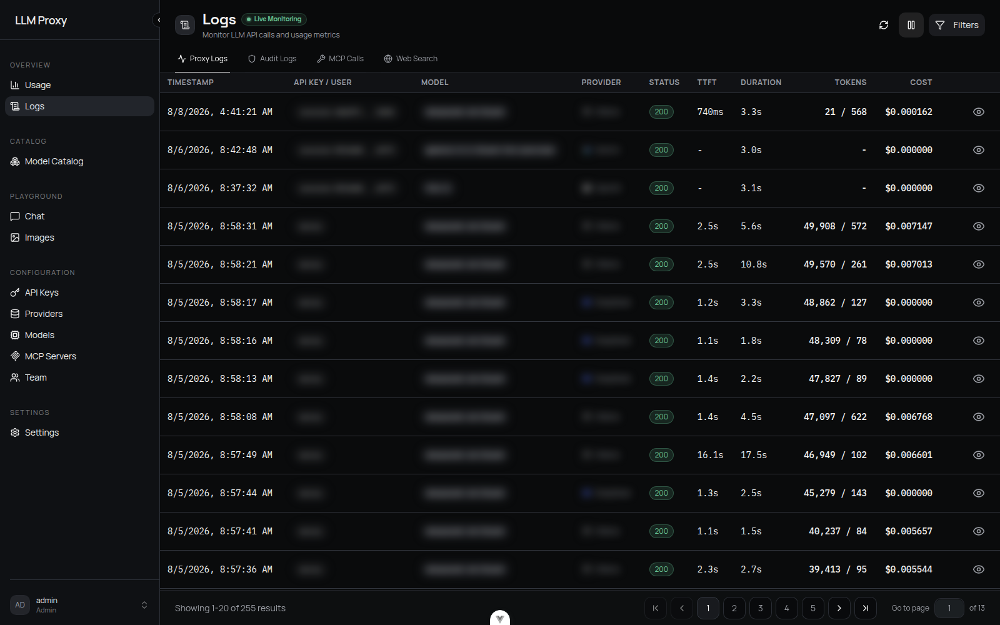

# Logs, Usage & Tracing

Every request through the proxy produces a log row, a usage record, and — when it is
an administrative or security event — a tamper-evident audit entry.

## Proxy Logs

**Logs → Proxy Logs** lists one row per request with timestamp, key/user, model,
provider, status, TTFT, duration, tokens, and cost. Open a row for the full request
and response bodies, headers, retry/fallback details, and (for smart-routed requests)
the routing decision.

| Field | Notes |
| --- | --- |
| `status_code` | Upstream or proxy status. `499` means the client disconnected mid-request and the upstream call was cancelled |
| `trace_id` | The correlation id handed to the tracing backend — the join key between a row and an exported trace when it is a canonical 32-character hex id (see *Tracing* below for the other case). `NULL` on rows written before the column existed and on rows that carry no trace. The list filter matches it exactly |
| `ttft_ms` | Time to first token (streaming) |
| `response_time_ms` | Total duration |
| Token counts | Prompt, completion, total; cache creation/read; cached prompt; audio in/out |
| `cost_usd` / `cache_savings_usd` | Billed cost and the estimated saving from cache reads |
| `fallback_count` | Provider switches this request needed. `0` = none, `>0` = that many providers failed before one served the request, `NULL` = row written before the column existed (unknown) — the list filter and the retries badge read it; the same count stays in `log_metadata` |
| `log_metadata` | `fallback_attempts`/`fallback_count`/`fallback_providers`, `retry_attempts`/`retry_count`, routing fields, `provider_model_name` |
| `client_ip`, `user_agent`, `auth_method` | Attribution, computed through trusted-proxy resolution |
| Bodies | JSON, or `{"$binary": true, "size": N}` for binary payloads. Streaming responses are reassembled into the protocol's non-streaming JSON unless **Log Raw Stream** is on |

**Zero is not "missing".** The token and cost columns keep a reported `0` distinct
from a value nobody reported: `0` is stored when the provider reported zero (the
whole prompt served from cache, an empty completion, a free request), `NULL` when
there is no measurement at all. The UI renders the latter as `-` with a "Not
reported" tooltip instead of a zero, so the two are never confused. Realtime turns
follow the same rule: a `response.done` that carried no usage stores `NULL` tokens
(and sets `usage_missing` in the metadata), while a usage block that reports zero
is stored as `0`. Rows written
before this rule existed may carry `0` for a measurement that only lives in
`log_metadata`; readers prefer a positive metadata value in that case.

**Filtering** (`GET /api/logs`): page or cursor pagination (max 200 per page), free-text
`search`, date range, exact status or status range, model, provider, user, API key,
endpoint, log type, `trace_id` (collect every row of one trace), and `had_fallback`
(`true` = at least one provider failed before
another served the request, `false` = no fallback recorded; rows written before
`fallback_count` existed are `NULL` and match neither). Non-admins are automatically
scoped to their own rows.

In the dashboard, the `trace_id` filter is not in the filter panel: open a row and use the
filter action on its trace badge to list every row of that trace, or link to
`/logs?trace_id=<id>`. The active filter is then shown (and cleared) from the chip above
the filter panel.

### Privacy controls

Configured in [Settings → Log Management](settings.md#log-management):

- **Bodies** (`log_input_output`, default **off**) is the master switch for persisting
  request/response bodies. Off, every row is still written (status, tokens, cost,
  routing, audit metadata, and headers) but every content payload is replaced by
  `{"_bodies_disabled": true}`: the request and response bodies, **upstream error
  bodies** and messages (`error_details.response_body` / `original_error` / `detail`),
  and **MCP arguments/results** and **web-search queries/results** in `log_metadata`.
  It is the master switch, not a sampling
  knob: `x-log-full: true` cannot re-enable bodies for one request — turn it on in
  Settings → Log Management (and back off when done) to inspect payloads.
  Diagnostic *reasons* are never scrubbed: the row's free-text `error_message` and
  `error_stack_trace` columns (the reason a request was rejected — rate limit vs
  budget vs upstream failure — which the rejection rows below depend on), the
  `error_type` / `status_code` / `provider` / `attempt` / `retried` fields of each
  fallback and retry attempt, and each attempt's own `error_message` (e.g.
  `429 rate limit exceeded`). That last one matters: when a provider fails and a
  fallback provider serves the request, the row's status is `2xx` and its
  `error_message` column is empty, so the attempt timeline is the *only* place the
  failure is recorded. The upstream payload those messages can echo lives in
  `log_metadata.error_details`, which *is* scrubbed.
- **Tracing content** is configured separately on the tracing provider. The Langfuse
  exporter's `send_content` setting defaults to `full`, so traces carry the prompt and
  completion. `inherit` instead makes these switches govern tracing too: with bodies
  off it exports **no** prompt/completion content (usage, cost, identity, timing and
  metadata are still exported), and with masking on it exports the same masked values
  the log row stores. `none` never exports content. See [Tracing](#tracing).
- **Sampling** (`sampling_rate`, default 1.0) limits **body capture** for requests that
  do have bodies enabled: sampled-out bodies are stored as `{"_sampled_out": true}` (a
  distinct marker, so the UI never reports "sampled out" when bodies are simply disabled)
  while metadata is still recorded. `x-log-full: true` forces full capture for one request.
- **Raw stream** (`log_raw_stream`, default off) controls how a *streaming* response is
  stored. Off, the accumulated content blocks are reassembled through the protocol
  serializer into the exact JSON a non-streaming call would have returned — the SSE
  envelope (`id`, `model`, `object`, `choices[0].index`, …) repeats on every delta, so
  the reassembled body is an order of magnitude smaller, and unlike the SSE text it is
  maskable and searchable. Measured on representative streams: ~45× smaller for Chat
  Completions, ~20× for Anthropic. On, the raw SSE frames are stored verbatim as a
  string. `x-log-full: true` forces raw for one request. A raw capture is stored
  **verbatim**, which is what makes it replayable — it is therefore not key-masked
  (the session masker works on JSON keys, and rewriting the frames would break the
  byte-exact replay it exists for); it is only bounded by the body size cap. Leave
  raw capture off if the streamed content itself must not be stored unmasked.
  The **native-passthrough** tier (the default for OpenAI-compatible providers on the
  `openai` protocol, and for Anthropic/OpenResponses-native providers) forwards
  upstream frames without running the content transformer. It still logs the
  reassembled body — each protocol rebuilds it from its own frames: native Chat
  Completions frames *are* `chat.completion.chunk` payloads, native Anthropic frames
  rebuild the message block by block, and a native Responses stream carries the whole
  response on its terminal event. Raw frames are kept only where there is no way to
  rebuild the body: a native tier whose protocol transformer cannot, and the generic
  streams (image generation and edit) whose payloads carry no content model. A stream
  whose body cannot be rebuilt stores `{"streaming": true, "_assembled": false}`, and
  nothing is stored when the request was sampled out or `log_input_output` is off.
- **Body cap** (`max_logged_body_bytes`, default `1048576` = 1 MiB; `0` = unlimited) limits
  body **size** at write time: a request or response body bigger than the cap is stored as
  `{"_truncated": true, "size": N}` (the original serialized size in bytes) instead of the
  payload. Since the cap is applied when the log row is built, it also truncates requests
  that forced capture with `x-log-full: true`; metadata is always recorded.
- **Masking** (`mask_sensitive_data`, default on) replaces credentials in headers,
  bodies, and MCP/tool arguments. Values ≤ 8 chars become `***`; longer values keep
  their first 3 and last 4 characters. Add your own field names via **Extra Sensitive Keys**.
  One policy applies to every row that stores content: ordinary requests, requests that
  failed before the pipeline started (backfilled from the request), admin/audit payloads,
  and MCP arguments. Admin payloads are masked even when `mask_sensitive_data` is off,
  because they carry credentials.
- **Retention** (`log_retention_days`, default 30; `0` = forever) is enforced by a
  sweep per log type that runs once a day. The sweep deletes in bounded
  batches, looping until exhausted — including request logs and usage
  records — so it never holds a single long write lock on a large store. A sweep that
  deleted rows is followed by a bounded `PRAGMA incremental_vacuum` and
  `PRAGMA wal_checkpoint(TRUNCATE)`, trimming the WAL and reusing freed pages on
  SQLite databases created with `auto_vacuum=INCREMENTAL`; existing database files
  keep their mode and reclaim space only via a one-time `VACUUM` (see
  [Databases](../deployment/databases.md)). Audit retention can be set separately.

### Rejected requests

Requests rejected before the pipeline still leave a row, so an API key whose traffic is
being refused is not invisible in Logs:

- Invalid API keys and IP lockouts are recorded as AUDIT rows by the auth middleware.
- Per-key **rate limits** (429), **budget caps** (429/503) and **model restrictions**
  (403) are recorded too. These rows carry the status and reason but deliberately **no
  body**: they are the path a client can trigger cheaply, so they must not become a
  write amplifier for prompt content. Repeated rejections for the same key and status
  are collapsed into one row per short window, so a client stuck in a retry loop cannot
  flood the log either; the collapsed attempts are reported in that row's metadata as
  `suppressed_since_last`. The window is per worker, so a multi-worker deployment can
  write up to one row per worker per window.
- Headers are kept on body-less rows (they are masked metadata), so a rejected or
  body-less request stays diagnosable.

### Durability

Logs and usage are written through in-process queues with background batch writers.
A full queue **drops** records (audit writes log an error instead); write failures
retry with backoff and open a breaker after 5 consecutive failures. On shutdown the
queues are drained (bounded at 5 s). Audit rows use a dedicated writer so endpoint
traffic cannot crowd them out.

## Usage analytics

The **Usage** dashboard and `GET /api/logs/usage-stats` aggregate:

- Summary: total cost, requests, input/output tokens, success rate, average response
  time, average TTFT, average tokens/second, cache creation/read tokens, cache savings.
- Breakdowns by provider and by model, plus a daily series.

Metrics come from the dedicated `usage_records` table, which is pruned on the same
retention window as the logs and survives the manual **Cleanup Logs** action; request
counts and success rate come from `request_logs` when available.
Budget windows, the per-key spend figures, and the per-key usage view include `judge`
usage records — a routing-judge call is billed on the key whose request triggered it,
so it appears in that key's by-model breakdown. The global **Usage** dashboard and the
Logs request counters stay `endpoint`-only, because a judge call is not a request the
client made.
Averages are the only latency/throughput statistics reported — no percentiles. Cache
savings require a `cached_read_cost_per_1m` price on the model; without it the metric
is skipped with a warning.

## Audit Logs

Administrative and security events (logins, member and key management, provider key
reveals, and every non-`/v1/` admin operation) are written to a **hash-chained** audit
log — each row's hash includes the previous row's, so removing or editing history is
detectable.

- **Chain**: `content_hash` = SHA-256 over a canonical JSON dump of the event,
  outcome, resource, model/provider, cost, tokens, and bodies. The stored link hash is
  SHA-256 of `"{sequence}:{content_hash}:{previous_hash}"`, with `GENESIS` as the seed
  of the chain.
- **Verify**: Logs → Audit Logs → **Verify Integrity**
  (`GET /api/logs/audit/verify-integrity`, admin only, optional sequence range)
  recomputes every hash and checks the linkage, returning `valid`, `verified_count`,
  and any errors.

Audit rows are admin-only in the console and API.

## MCP Calls, Web Search and Judge Calls tabs

| Tab | Contents |
| --- | --- |
| **MCP Calls** | One row per MCP operation: server, operation, resource type/name, arguments and result summary (masked), status, duration |
| **Web Search** | One row per intercepted search: query, provider, status, result count, max uses vs. current use |
| **Judge Calls** | One row per routing-judge call (log type `judge`): judge model, provider, resolved upstream model, tokens, cost and its source, status, duration, plus gate, shadow flag, verdict and error in metadata. Attributed to the request that triggered the call, which is named as `parent_request_id` |

A judge row is written before its parent request is served, so a call is still
accounted for when the parent later fails. Its request id is the parent's with a
`:judge` suffix. Bodies are never stored on these rows: the input is a bounded excerpt
the parent row already holds, and the output is the verdict in metadata.

## Tracing

Tracing is **per user** (Settings → General → Tracing). Each user configures their
own backends, and those backends only ever see that user's requests: there is no
global tracing configuration. Three backends are built in, beside the always-on
internal audit handler:

| Provider | Sends traces to | Transport | Credentials |
| --- | --- | --- | --- |
| `langfuse` | Langfuse cloud or a self-hosted instance | Langfuse SDK | public + secret key |
| `otel` | Any OTLP collector — Tempo, Jaeger, Phoenix, Grafana, … | OTLP/HTTP or gRPC | optional `Authorization` header / gRPC metadata |
| `langsmith` | LangSmith's OTLP gateway | OTLP/HTTP | API key, optional project and workspace id |

When enabled, each request exports one observation, named after its endpoint and
carrying that request type's own content:

- **chat** (OpenAI, Anthropic and Responses wire): a `generation` whose `input` is the
  messages (or `{tools, messages}` when tools are present) and whose `output` is the
  assistant message with tool calls separated out. When the client and the provider
  speak the same wire the response is passed through unparsed, so no content blocks
  exist to render: the trace uses the response body's wire shape, passed through the
  same bounded rendering as every other trace payload (long text, inline binary data
  and unbounded lists are summarized) and the standard masking policy.
- **embeddings** (`/v1/embeddings`): an **`embedding`** observation. `input` is the
  text (or list of texts) being embedded; `output` is the response shape (`count`,
  `dimensions`, `model` and a preview of the first vectors) rather than the vectors
  themselves — a single vector is 768–3072 floats and a batch is unbounded, so
  exporting them whole would dwarf the span. `usage_details` carries the `input`
  bucket only, since an embedding bills no output tokens.
- **rerank** (`/v1/rerank`, `/v2/rerank`): `input` is `{query, documents}` (documents
  capped at the first 20, long ones cut at 2000 characters, with the true count
  reported); `output` is the ranking — `index`, `relevance_score`, and the echoed
  document when the upstream returns one.
- **images** (`/v1/images/generations`, `/v1/images/edits`): `input` is the prompt plus
  the image parameters, and an edit's source images and mask are summarized by
  filename, content type, size or URL. `output` keeps the result URLs; base64 image
  data appears as a length.
- **audio** (`/v1/audio/speech`, `/v1/audio/transcriptions`, `/v1/audio/translations`):
  a speech request's `input` is the script and its `output` the media type and byte
  count; a transcription or translation `input` is the uploaded file's name and size
  and its `output` the transcribed text (segments are counted, not repeated).
- **systemone**/**decisions**: `input` is the evaluation's `state`/`input` plus its
  `questions`, and `output` is its `answers`.
- No binary payload ever reaches a trace: audio, image bytes, inline data URIs and
  base64 vectors are reported by media type, length or URL. Every text leaf of a
  client-supplied payload (embedding texts, documents, decisions evidence, System One
  state, a rerank document's extra keys) is cut at 2000 characters, and a long list
  keeps its first 20 items plus a truncation marker.
- A **streaming** image, speech or transcription request ends with `input`, usage,
  cost and metadata but no `output`: a generic stream has no assembled result object
  (chat streams do, and their accumulated assistant message is exported).
- `usage_details` as **mutually exclusive** buckets: `input`/`output` exclude the
  cache, audio and reasoning detail counts, which are emitted under their own
  buckets (`cache_read_input_tokens`, `cache_creation_input_tokens`,
  `input_audio_tokens`, `output_audio_tokens`, `output_reasoning_tokens`) so
  Langfuse's inferred cost does not double-count them. `cost_details.total` is the
  proxy-computed (or provider-reported) USD total.
- A `tool` observation per tool call the model requested.
- Trace-level attributes via `propagate_attributes`: trace name, **user id** and
  **session id**. Metadata carries the request id, trace id, provider, endpoint,
  latency, TTFT, token details not used as buckets, cache savings, and fallback/retry
  information.

In Langfuse, the observation type is `generation` for every request type except
embeddings:
Langfuse records usage and cost on `generation` and `embedding` observations only, so a
billed call keeps its priced home. Version segments are stripped from the name, so
`/v1/rerank` and `/v2/rerank` both read `rerank`, and the double-version aliases
(`/v1/v1/chat/completions`) collapse to the canonical name as well.

**The two OTLP backends** export one `CLIENT` span per request, named
`{operation} {model}`, with the OpenTelemetry GenAI attributes:
`gen_ai.operation.name` (`chat`, `embeddings`, `generate_content`, or the proxy's own
`rerank`/`speech`/… for types the conventions do not name), `gen_ai.request.model`,
`gen_ai.response.model`, `gen_ai.request.*` sampling parameters,
`gen_ai.usage.input_tokens`/`output_tokens`/`total_tokens` (inclusive, as the
conventions define them) with the cache-read, cache-write and reasoning details beside
them, and `gen_ai.conversation.id` for the session. The projected input and output are
attached under `input.value`/`output.value` (the OpenInference spelling), and the
proxy's own facts — request id, provider, endpoint, latency, TTFT, cost, cache savings,
fallback/retry counts — under `llm_proxy.*`. TTFT is also recorded as a
`gen_ai.first_token` span event. A failed request ends as an error span: `error.type`,
the recorded exception, and `StatusCode.ERROR`.

The LangSmith backend additionally emits the spellings its ingest reads:
`gen_ai.system` for the upstream provider, flattened
`gen_ai.prompt.*`/`gen_ai.completion.*` message attributes,
`langsmith.trace.session_id`, `langsmith.span.tags` and `langsmith.metadata.*`. It
speaks HTTP only — LangSmith has no gRPC ingest — and it ingests traces only, not
metrics or logs. Its ingest materializes a trace only when its root span arrives, so
the LangSmith backend exports every request as its own root run and does not continue
a caller's `x-trace-id` as a parent span (the gateway accepts such an orphan span with
HTTP 200 and then drops it); the correlation id travels as
`llm_proxy.correlation_id`/`langsmith.metadata.correlation_id` instead.

**Content policy.** Every backend exports the prompt and completion by default: its
`send_content` setting is `full`, so enabling tracing records input/output.
`inherit` instead follows the log privacy switches —
`log_input_output` off means no prompt/completion content is sent (usage, cost, model,
identity, timing and metadata still are), and `mask_sensitive_data` on means the same
masked payload the log row stores is sent. `none` never sends content. Tool
observations follow the same decision.

Correlate a trace with a request by sending `x-langfuse-trace-id` (or `x-trace-id`);
when it is a canonical 32-character hex Langfuse trace id the proxy's generation is
nested inside that trace, otherwise the proxy starts its own trace. The proxy echoes a
trace id header on responses and both headers are CORS-exposed. A generated trace id is
also a 32-character hex id and is stored on the log row as `trace_id`, so a row and its
Langfuse trace can be found from either side (the logs API filters on `trace_id`).

## Related

- [Settings](settings.md#log-management) — retention, masking, sampling
- [Cost Control](../guides/cost-control.md) — turning usage data into budgets
