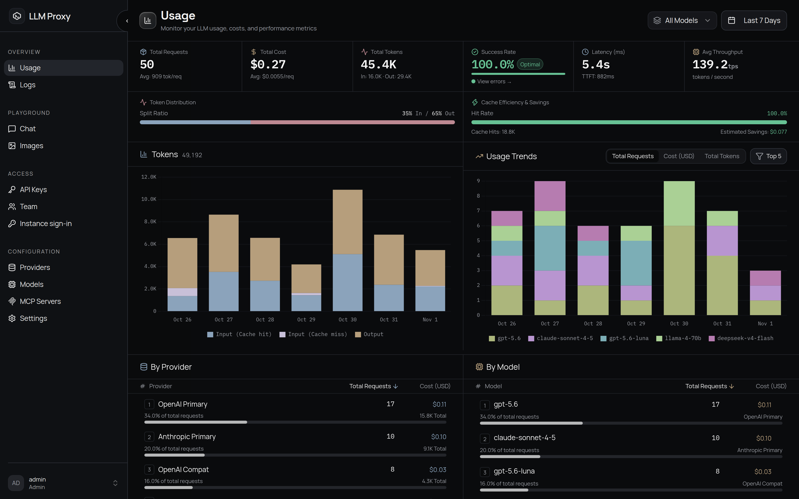

LLM Proxy is a self-hosted gateway for LLM APIs. Point an existing OpenAI or Anthropic
SDK at it, or a Cohere SDK at the rerank endpoint. The proxy sends each request to the
upstream that serves the requested model and translates the response back. Fallback,
cost-aware routing, budgets, request logging, and the admin console are built in, and
configuration changes do not require a restart.



## How it works

```text
Client                     LLM Proxy                                  Upstream
OpenAI / Anthropic /  ──▶  parse to InternalRequest                   provider API
Cohere rerank wires        route: mapping, allowlists, budgets,   ──▶  (built-in
                           retries, fallback, circuit breaker           adapters)
                      ◀──  translate back to the client's protocol
```

A protocol serializer parses and renders the client wire format. A provider serializer
renders the same internal model for the upstream. A request can enter as OpenAI Chat
Completions and leave as Anthropic Messages, or be forwarded verbatim when both sides use
the same protocol. [Core Concepts](getting-started/concepts.md) explains the terms.

## Protocol translation

| Protocol | Endpoint |
| --- | --- |
| **OpenAI Chat Completions** | `POST /v1/chat/completions` |
| **OpenAI Responses** | `POST /v1/responses` (retrieve, delete, cancel, input items, compact, SSE and WebSocket) |
| **Anthropic Messages** | `POST /v1/messages` (+ `POST /v1/messages/count_tokens`) |
| **Cohere-compatible rerank** | `POST /v1/rerank` (alias `POST /v2/rerank`) |
| **Evaluation** | `POST /v1/systemone` · `POST /v1/decisions` |
| **OpenAI-compatible utilities** | `/v1/embeddings` · `/v1/images/generations` · `/v1/images/edits` · `/v1/audio/speech` · `/v1/audio/transcriptions` · `/v1/audio/translations` · `/v1/models` |

The full route list, auth column, and provider capability matrix are in the
[Endpoint Index](api/endpoints.md).

## Smart routing and resilience

- Virtual models: send `auto`, `fast`, or `best`. The built-in classifier uses
  structural, Unicode, and n-gram features (it does not call an LLM) and picks a model by
  complexity, cost, and capability. An optional routing judge handles ambiguous first
  turns.
- Cost-aware selection uses the `ECONOMY`, `BALANCED`, and `PREMIUM` tiers, with
  bandit-style exploration that learns from real outcomes.
- Fallback and circuit breakers: attempts are tracked per provider. Failures retry, and a
  breaker stops requests to a provider that keeps failing.
- Keepalive heartbeats keep slow non-streaming requests alive behind CDNs. Requests
  abandoned by the client are cancelled and logged as 499.

## MCP and web search

- MCP servers: attach stdio or HTTP servers once, and every MCP client can reach them at
  `/servers/<name>/mcp` with the same API keys, budgets, rate limits, and logs as model
  traffic. Per-key allowlists and a deny-by-default policy limit process execution and
  outbound requests.
- Web search: `web_search` calls from any client are answered through your SearXNG or
  Ollama backend and injected back in the client's format, including Anthropic.

## Cost control and billing

- Prices can be set per model for input, output, cached input, audio, and image tokens,
  with one-click sync from [models.dev](https://models.dev).
- Budgets can be daily, weekly, or monthly USD windows per API key, plus an account budget
  that covers all keys owned by a member.
- Token counting uses tiktoken and tracks cache hits. The dashboard estimates savings from
  cached reads.

## Observability

- Request logs record TTFT, duration, tokens, cost, status, retries, and fallbacks.
- Usage analytics show trends, provider and model breakdowns, cache efficiency, average
  latency, and throughput.
- Audit events are hash-chained, and the console can verify their integrity.
- Tracing supports Langfuse, any OTLP collector (Tempo, Jaeger, Phoenix, Grafana), or
  LangSmith, configured per account or server-wide.

## Security

- Teams use `admin` and `viewer` roles. Users can have model allowlists, account budgets,
  and rate limits. Invitations, passkeys, TOTP two-factor, and OIDC are supported.
- API keys can carry model allowlists, MCP allowlists, requests-per-minute limits, an
  expiry date, and spend tracking.
- Abuse protection includes sliding-window rate limiting (memory or Redis), login
  lockout, HSTS, request-size limits, and trusted-proxy-aware client IP resolution.
- The JWT secret and API-key encryption key are generated and stored on first run.

## Documentation map

| Section | What is inside |
| --- | --- |
| [Getting Started](getting-started/installation.md) | Install, first-run setup, connect an SDK or coding agent, concepts |
| [Deployment](deployment/docker.md) | Docker Compose, databases, reverse proxy, upgrades |
| [Admin Console](admin/overview.md) | Every dashboard screen and server setting, explained |
| [API Reference](api/index.md) | Endpoints, auth, streaming, tools, routing, errors, OpenAPI |
| [Guides](guides/cost-control.md) | Cost control, monitoring, security hardening |
| [Reference](reference/environment.md) | Environment variables, FAQ |

## License

MIT. See [LICENSE](https://github.com/zwldarren/llm-proxy/blob/main/LICENSE).
