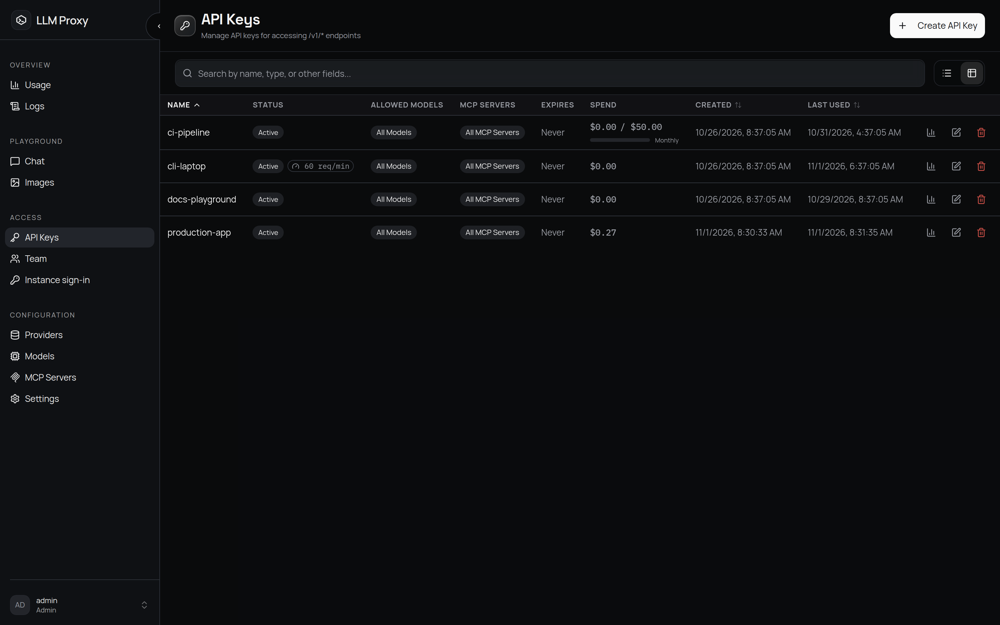

# API 密钥

应用调用代理时用的就是 API 密钥。每个客户端、服务或环境各建一个，就能分别吊销、分别设预算、分别限速。

## 创建密钥

**API 密钥 → 创建 API 密钥**。字段如下：

| 字段 | 含义 |
| --- | --- |
| **名称** | 密钥的唯一标识（1–255 个字符）。之后每次操作都用这个名字，建议写成 `prod-backend` 这样的形式 |
| **允许的模型** | 不选表示允许所有模型；明确清空表示全部拒绝。非管理员的选项必须是该用户自身模型白名单的子集 |
| **允许的 MCP 服务器** | 不选表示允许所有 MCP 服务器。**仅管理员可用**——viewer 提交这个字段会被代理静默丢弃（等同允许所有服务器） |
| **过期时间** | 可选的 ISO 8601 时间戳；留空表示永不过期 |
| **预算** | 可选的美元上限，配合周期使用：`daily`、`weekly`、`monthly`，或不设周期的总额（从上次重置起累计） |
| **预算重置日** | 1–31，仅用于按月预算；默认每月 1 日（UTC） |
| **速率限制（RPM）** | 可选的单密钥每分钟请求上限。**仅管理员可用**——viewer 设置会返回 403。要给成员的所有密钥设上限，请用 [团队](/zh/admin/users#account-rate-limits) 里的账户速率限制 |

明文密钥（`sk-` 加 64 个十六进制字符）**只显示一次**，且必须先勾选「我已保存该密钥」才能关闭对话框。代理只保存该密钥的 SHA-256 摘要——丢了就删掉密钥重新创建（没有轮换接口）。

::: warning 密钥按所有者隔离
即使是管理员，**API 密钥**页也只显示自己的密钥。要管理别人的访问权限，请用 [团队](/zh/admin/users)，或让对方自己创建密钥。
:::

## 预算 {#budgets}

预算在请求时校验。当前窗口的花费达到上限后，后续请求返回 **HTTP 429** 和错误码 `budget_exceeded`；管理员配置的账户预算对应的错误码是 `user_budget_exceeded`。

窗口按 UTC 日历计算：

| 周期 | 窗口起点 |
| --- | --- |
| `daily` | UTC 00:00 |
| `weekly` | 周一 UTC 00:00（ISO 周） |
| `monthly` | 配置的重置日（默认 1 日），短月份会截断到月末 |
| 总额（`null`） | 从上次手动重置或密钥创建时算起 |

实际生效的窗口起点取日历边界和上次手动重置两者中较晚的一个。预算检查是失败关闭的：读不到花费就直接拒绝请求。

- 重置：点击密钥上的 **重置** 会记录一个重置时间；之后窗口只统计该时间点之后的用量，被预算拦住的密钥也随之恢复可用。密钥预算由所有者自助管理，随时可以调高、调低、清空或重置。
- 花费查询：`GET /api/api-keys/spend/summary`（所有密钥）和 `GET /api/api-keys/{name}/usage`（单个密钥，可指定日期范围）。
- 账户预算：管理员还可以给每个用户设一个覆盖其所有密钥的上限。这种预算只能在 **团队** 里重置，详见 [用户与角色](/zh/admin/users#account-budgets)。

::: note 查询范围与生效窗口不是一回事
用量面板里的日期范围只是方便你查看；预算本身始终按上面说的 UTC 日历窗口计算。
:::

## 速率限制、过期与白名单

- `rate_limit_rpm` 是按密钥生效的滑动窗口每分钟请求数限制。它由管理员在自己的密钥上设置；针对成员整体的上限则配置在 [团队](/zh/admin/users#account-rate-limits) 里。
- `expires_at` 过期后会自动禁用密钥。
- `allowed_models` 和 `allowed_mcp_servers` 在每次请求时校验。不在模型白名单里的模型会在调用上游之前就被拒绝。MCP 白名单按**服务器**生效，不细到工具：一旦允许某个服务器，它的工具调用就会原样转发。

## 管理密钥

| 操作 | 效果 |
| --- | --- |
| **编辑**（`PUT /api/api-keys/{name}`） | 修改名称、白名单、过期时间、预算、速率限制，或切换 `is_active` |
| **禁用** | `is_active: false`——带该密钥的请求立即被拒绝 |
| **删除** | 不可恢复；用量历史会保留 |

::: tip 轮换
先创建新密钥、更新客户端，再删除旧密钥。旧密钥在禁用或删除之前一直可用，所以轮换不需要停机。
:::

## 相关页面

- [用户与角色](/zh/admin/users)：每个用户的账户预算和模型白名单
- [错误与速率限制](/zh/api/errors)：客户端收到的 429 响应细节
- [成本控制](/zh/guides/cost-control)：一套实用的预算工作流
