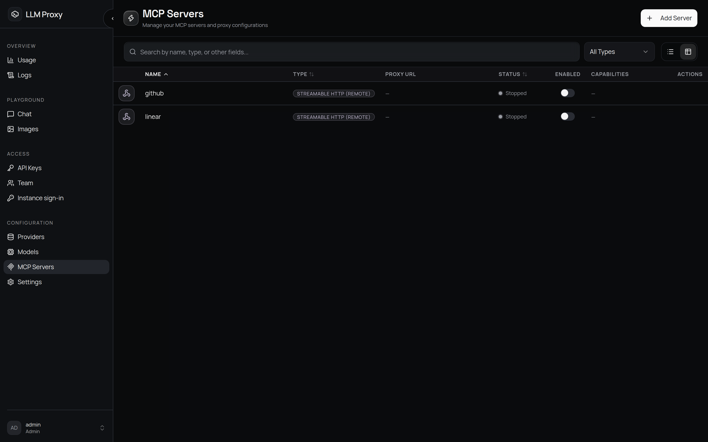

# MCP 服务器

LLM Proxy 可以把 [Model Context Protocol](https://modelcontextprotocol.io) 服务器托管在网关后面。每个配置好的服务器都会在固定 URL 上对外提供：

```
https://your-proxy/servers/<server-name>/mcp
```

MCP 客户端（Claude Code、Codex、Cursor、自研 agent 等）用代理 API 密钥连接这个 URL，看到的工具、资源和提示词与后端服务器自己暴露的完全一致——代理原样转发 `tools/list`、`tools/call`、`resources/*` 和 `prompts/*`。工具名**不会**被重命名。

::: info 两类流量
`/servers/*` 是 MCP 端点，不是面向模型的工具注入：代理不会把 MCP 工具塞进 `/v1/*` 请求。把 MCP 客户端连到 `/servers/<name>/mcp`，用 [API 密钥](/zh/admin/api-keys) 授权——同一套密钥、预算、速率限制和日志都适用。
:::



## 添加服务器

**MCP 服务器 → 添加服务器**：

| 字段 | 适用类型 | 说明 |
| --- | --- | --- |
| **名称** | 两者 | 必须唯一；会作为 URL 路径段。可以包含斜杠 |
| **类型** | 两者 | `stdio` 或 `streamableHttp` |
| **命令** | stdio | 必填。必须通过[安全策略](#security-policy)检查 |
| **参数** | stdio | 自由格式列表；包含 shell 元字符（`;`、`&&`、`\|\|`、`\|`、`$(`、反引号、`>`、`<`）会被拒绝 |
| **环境变量** | stdio | 键必须在白名单内；不在白名单内的键会被静默丢弃 |
| **基础 URL** | streamableHttp | 必填。必须是 `http`/`https`，并通过 SSRF 检查 |

已启用的服务器会立即启动，并在每次进程启动时自动拉起（启动失败会记日志，但不会中断启动流程）。

::: warning 不支持自定义 HTTP 头
访问远程（`streamableHttp`）服务器时不会附带额外请求头——目前没有按服务器的请求头/认证字段。请使用你可控的网络路径，或改用通过 URL 认证的后端。
:::

## 谁可以管理服务器

MCP 服务器会在主机上执行进程、发起对外请求，因此**创建和管理服务器仅限管理员**。普通成员不能创建、编辑、启停或删除服务器。

成员可以通过代理*使用*管理员创建的服务器，并用单密钥白名单控制自己的哪些 API 密钥能访问哪个服务器（见 [限制访问](#restricting-access)）。只读接口 `GET /api/mcp/server-names` 会返回成员配置白名单所需的服务器名，同时不暴露任何服务器配置。

## 连接客户端

把 MCP 客户端指向代理 URL，并给它一个 API 密钥：

```json
{
  "mcpServers": {
    "github": {
      "type": "streamableHttp",
      "url": "https://llm.example.com/servers/github/mcp",
      "headers": { "Authorization": "Bearer sk-your-proxy-key" }
    }
  }
}
```

- 认证接受 `Authorization: Bearer sk-…` 或 `x-api-key: sk-…`；控制台 JWT **不**被 `/servers/*` 接受。
- 控制台创建的会话密钥（`sk-ui-…`）同样可用。
- 请求会经过与模型流量相同的保护：无效密钥的 IP 锁定、单密钥 RPM 限制和预算上限（无法确认的预算检查返回 **503**，失败关闭）。

## 限制访问

**单密钥白名单**（API 密钥上的 `allowed_mcp_servers`）：

| 取值 | 含义 |
| --- | --- |
| 未设置 | 允许所有 MCP 服务器 |
| 空列表 | 拒绝所有 MCP 服务器 |
| 名称列表 | 只允许列出的服务器 |

每个密钥所有者都能在自己的密钥上设置这个字段。策略变更最多缓存 60 秒。全局开关 `require_key_mcp_permissions`（设置 → 常规 → MCP 安全）会关掉整套检查——关闭后任何有效密钥都能使用任何服务器。

## 安全策略 {#security-policy}

MCP 服务器会代表你执行进程、发起对外 HTTP 请求，所以代理默认拒绝一切。相关配置在 **设置 → 常规 → MCP 安全**：

| 设置 | 默认值 | 行为 |
| --- | --- | --- |
| 要求密钥 MCP 权限 | 开 | 关闭 = 任何有效密钥都能使用任何服务器 |
| 允许的命令 | *（空）* | 为空表示**不允许**任何 stdio 命令。条目可以是裸文件名（`npx`——允许任意调用方式），也可以是完整调用（`npx mcp-searxng`） |
| 禁止的命令 | `bash`、`sh`、`zsh`、`cmd.exe`、`powershell.exe`、`python`、`python3`、`node`、`perl`、`ruby` | 始终拒绝，即使在允许列表里 |
| 允许的环境变量键 | *（空）* | 为空表示不传递任何自定义环境变量 |
| 禁止的环境变量键 | `PATH`、`LD_PRELOAD`、`DYLD_INSERT_LIBRARIES`、`PYTHONPATH`、`NODE_OPTIONS`、`SHELL`、`HOME`、`USER` | 始终剥离 |
| 禁止的 URL 主机 | *（空）* | `streamableHttp` 的主机名拒绝列表 |
| 禁止的 URL IP | loopback、RFC1918、link-local、`169.254.169.254`、CGNAT 及其 IPv6 对应段 | SSRF 防护；主机名会先做 DNS 解析，只要有**任意**一个解析结果被禁止就拒绝（缓解 DNS rebinding） |

一次工具调用、提示词或资源应答的内容块合计最多 8 MiB（`MCP_MAX_RESULT_BYTES`）；超出上限的文本和二进制内容会被截断并打上标记，该次调用也会以 `truncated: true` 记录日志。模型每一轮都可能调用工具，如果不设上限，一个行为失控的服务器就能决定代理要占多少内存。

检查在服务器创建或更新时执行一次（返回 HTTP 422），在后端启动时再执行一次。不允许的环境变量键会被丢弃而不是报错——保存后的配置里只留下实际生效的部分。

由于默认允许列表为空，全新安装会拒绝所有 stdio 服务器，直到你放行某个命令。控制台会直接提示这一点：服务器表单在你输入时实时对照当前策略检查命令、参数和环境变量键，不满足时给出指向 **MCP 安全** 的链接；API 报错也会指出被拒绝的命令，并指向同一个设置项。

::: tip 典型的允许列表条目
对于基于 Node 的服务器：允许命令 `npx`（或精确的 `npx @scope/server` 形式），并且只添加该服务器需要的环境变量。容器里自带 `bunx` 和 `uvx`，所以 Python/Node 的 MCP 服务器无需额外安装。
:::

## 生命周期与限制

- 启动/停止：创建、启用（`PUT enabled: true`）、禁用（`PUT enabled: false`）、删除。禁用会停止进程，启用会启动它。
- 没有重启接口：编辑*运行中*服务器的 command/args/env/base_url 会重启其进程使新定义生效，既作用于处理这次编辑的工作进程，也作用于之后采用该变更的所有同僚进程。
- 状态（`GET /api/mcp/servers/{name}/status`）从内存注册表返回 `running`/`stopped`。没有周期性健康检查；stdio/HTTP 后端在连接出错时会尝试一次性重连。
- 能力（`GET /api/mcp/servers/{name}/capabilities`）返回运行中服务器声明的工具、提示词和资源。在控制台里，服务器行上的 **查看详情** 会打开能力对话框。已停止的服务器没有能力。
- 超时：每个后端操作的超时上限为 **30 秒**（不可配置）。慢工具会以 MCP 超时错误失败。

## 可观测性

每次 MCP 操作都会记录日志（日志 → **MCP 调用**）：服务器、操作、资源类型/名称、状态、耗时，以及经过敏感字段掩码的参数/结果。服务器的启停事件同样会记录。
