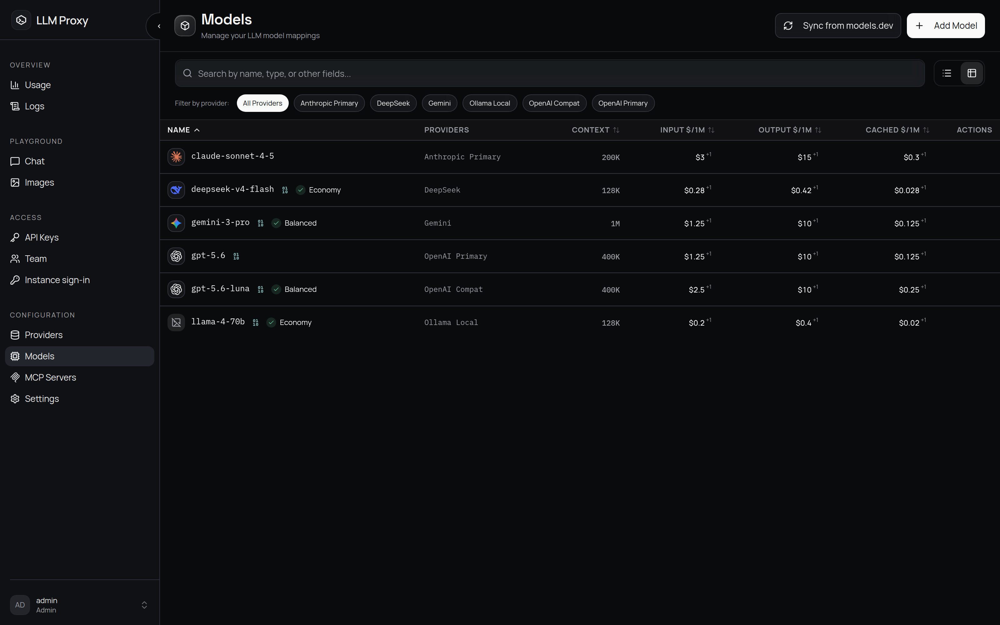

# 模型与定价

**模型记录**就是客户端在请求里发送的 `model`——名字由你起，映射到一个或多个提供商，
并带上能力标记、上下文长度和价格。

## 模型记录的构成

| 部分 | 作用 |
| --- | --- |
| **名称** | 面向客户端的别名（例如 `gpt-5.6-luna`）。唯一，只做精确匹配——不支持通配符 |
| **提供商映射** | 每个能服务该模型的提供商一条：`provider_name`、上游的 `provider_model_name`、以及 `priority` |
| **能力标记** | `supports_images`（视觉）、`supports_image_generation`、`supports_tts`、`supports_stt`、`supports_embedding`、`supports_rerank`、`supports_realtime`、`supports_systemone`（决策模型） |
| **目录元数据** | `context_length`、`max_output_tokens`、系列、发布日期、知识截止时间，以及 models.dev 属性（`attachment`、`reasoning`、`tool_call`、`structured_output`、`temperature`、`open_weights`、`status`） |
| **定价** | 模型级费率，可按映射覆盖（见下文） |
| **参数覆盖** | 由提供商配置 → 模型 → 映射逐层注入的额外参数（越具体越优先） |
| **重试/超时** | `max_retries` 覆盖该模型使用的全局默认值 |
| **智能路由字段** | `auto_eligible`、`quality_tier`（`economy`/`balanced`/`premium`）、`routing_assignments`，仅在开启[智能路由](/zh/api/routing)时使用 |

并非每个标记在所有环节都会生效：`supports_images` 和 `context_length` 用于筛选
智能路由候选，`supports_realtime` 在 Realtime WebSocket 上强制检查，
`supports_rerank` 是 `/v1/rerank` 的门槛（不具备该标记的模型会被 `400` 拒绝），
`supports_systemone` 标记决策模型——它同时是 `/v1/systemone` 和 `/v1/decisions`
两个评估端点的门槛；其余标记只是目录和展示用的元数据。

## 提供商优先级与回退 {#provider-priority-and-fallback}

- 选择时用的是**映射**上的 `priority`（越高越优先）：提供商自身的 `priority` 字段
  不参与。
- 候选按映射优先级分组；先试最高的非空组，然后依次试其余各组。
- 同一组内，由全局的[提供商选择策略](/zh/admin/settings#provider-selection)决定顺序（默认
  `session_sticky`，也可选 random/cost-optimized/balanced）。
- 每个映射在每个请求中只尝试一次。失败后先在提供商内部重试（`max_retries`），再跨
  提供商回退（`max_fallback_attempts`）。
- 只要还有映射可试，**任何**提供商错误都会回退到下一个。上游的状态码或错误类型从不
  阻止回退，因为提供商经常错报错误（例如上下文窗口超限却返回一个泛泛的 `400`）。
- `408/429/500/502/503/504` 以及网络/超时错误会先重试，再回退；其他错误直接切到下一个
  提供商。

## 定价 {#pricing}

所有价格都以**美元**计。除特别说明外，费率按每 1M Token 计算：

| 字段 | 单位 |
| --- | --- |
| `input_cost_per_1m`、`output_cost_per_1m` | Token |
| `cached_read_cost_per_1m`、`cached_write_cost_per_1m` | Token（缓存命中/写入） |
| `reasoning_cost_per_1m` | 推理/思考 Token |
| `audio_input_cost_per_1m`、`audio_output_cost_per_1m` | Token |
| `image_input_cost_per_1m` | Token |
| `cost_per_image` | 每张生成的图像 |
| `audio_cost_per_minute` | STT 时长 |
| `tts_cost_per_1m_chars` | TTS 字符数 |
| `web_search_cost_per_1k` | 联网搜索请求数 |

会影响账单的细节：

- 取值顺序：映射的费率逐字段优先于模型级费率；提供商级 `pricing_tiers` 优先于
  模型级分层。
- 分层（`pricing_tiers`）按输入 Token 阈值计费：取满足 `threshold <= 输入 token`
  的最高一层；未设置的维度沿用基础费率。阈值必须唯一。按单位计费的费率（图像、音频
  分钟、TTS 字符、搜索次数）从不分层。
- 时间窗口（`pricing_time_windows`）按钟点计费，用于高峰/低谷定价（火山引擎方舟、
  DeepSeek 曾经的夜间折扣）。一个窗口是 `HH:MM` 的 `start`/`end`，加上可选的 `days`
  列表（ISO 星期，留空表示每天）和 IANA `timezone`（默认 `UTC`）。它作用于**在其
  内部开始**的请求，按窗口所在时区读取；`end` 等于或早于 `start` 表示跨过午夜，`days`
  指的是窗口开始的那一天。不在任何窗口内的请求按基础费率计费。窗口在真实（UTC）时间上
  不得重叠，跨时区时也一样——整个请求由第一个匹配的窗口重新计价，一旦重叠，账单就会
  取决于列表顺序。models.dev 不发布这类数据——请手动录入。
- 服务层级（`service_tier_pricing`）按请求实际使用的服务层级计费：一个从模式名
  （`flex`、`priority` 等）到费率的映射，由请求的 `service_tier` 选取（提供商回报的
  层级优先于请求里写的层级）。没有对应条目的层级沿用前面各层叠加后的费率（没有命中
  时间窗口时即标准价）。数据来自 models.dev 的 `experimental.modes`。
- 提供商覆盖：对分层、时间窗口和服务层级，提供商映射有三种状态：缺失/`null`
  沿用模型级取值，非空值覆盖它，空列表/空映射则为该提供商关闭这一层叠加。
- 叠加顺序：基础费率 → 上下文档位 → 时间窗口 → 服务层级。每一层只替换它设置了的
  维度，整个请求会重新计价；它们都不是边际费率。
- 推理 Token 已经计入 `output_tokens`；设置了 `reasoning_cost_per_1m` 时会把它们
  单独拆出并按该费率收费，否则按输出费率计费。
- 缓存 Token 会从基础输入费率改按缓存读/写费率计价，差额记为
  `cache_savings_usd`。没有基础输入费率时，缓存 Token 直接按缓存费率收费。
- 音频/图像 Token 在有专属费率时会从 prompt/completion Token 中拆出，因此不会被
  重复计费。
- 提供商上报的成本优先于 `openrouter` 和 `nanogpt`：用它们自己的数字替换计算出的
  成本。
- `cost_usd = null` 表示「未知」，不是免费：没有可计费用量，或者任何层级都没有
  配置费率时，它就是 null。对于没有上游用量的聊天请求，会先估算 Token 再计价。

### 从 models.dev 同步

模型页面上的**从 models.dev 同步**对话框有两个标签页：**定价**和**能力**。**定价**页
从 [models.dev](https://models.dev) 目录拉取数据
（`POST /api/config/models/sync-pricing`；进程内缓存 1 小时，上游失败时有 5 分钟的
过期宽限）：

1. 预览（`dry_run: true`）按映射显示差异，匹配依据是 `provider_model_name`
   （匹配不到时回退到代理的模型名）。
2. 应用只写入**映射级**定价，不动模型级费率。已经带有自定义费率或分层的映射会被
   跳过，除非你关闭*保留自定义定价*。
3. 之后可以在模型编辑器里逐行手工调整，或调用
   `POST /api/config/models/pricing/apply`（部分更新；`null` 会清空字段）。

同步还会拉取 `cost.reasoning`（推理 Token 费率）、每个上下文档位的 `reasoning` 费率，
以及 `experimental.modes`（服务层级价格表）。它从不写入 `pricing_time_windows`：目录
无法表达按时段定价，因此同步不会改动手工编写的窗口列表。

**能力**页把能力/目录字段与 models.dev 对比，并应用你审阅过的差异
（`POST /api/config/models/metadata/apply`；`supports_images` 由模型是否接受图像输入
推导）。目录中缺少数据从不计为一项变更。

## 客户端能看到什么

| 入口 | 内容 |
| --- | --- |
| `GET /v1/models` | 面向客户端的列表：每个已配置的模型名，加上优先级最高的提供商，按 API 密钥的白名单过滤。开启智能路由时会包含 `auto`/`fast`/`best` |
| `GET /api/catalog/models` | 供界面展示的目录（不含定价）；同样按白名单过滤 |
| **模型**页面（管理员） | 完整的管理视图 |
| **模型**页面（查看者） | 该账户可用内容的只读目录 |

## 相关

- [提供商](/zh/admin/providers)：这些模型指向的上游
- [虚拟模型与路由](/zh/api/routing)：`auto`/`fast`/`best`
- [成本控制](/zh/guides/cost-control)：价格 → 预算 → 执行
