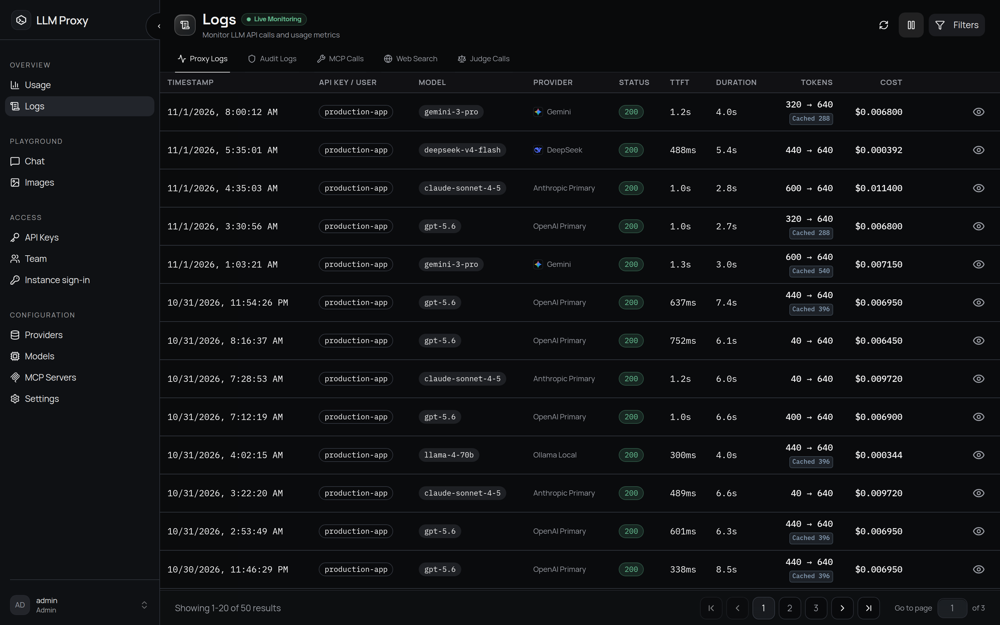

# 日志、用量与追踪

每个经过代理的请求都会产生一行日志、一条用量记录；如果是管理或安全事件，还会写入
一条防篡改的审计记录。



## 代理日志

**日志 → 代理日志** 里每个请求一行，包含时间戳、密钥/用户、模型、提供商、状态、首字
时间（TTFT）、耗时、Token 和费用。点开一行可以查看完整的请求与响应正文、请求头、
重试/回退详情；智能路由的请求还能看到路由决策。

| 字段 | 说明 |
| --- | --- |
| `status_code` | 上游或代理返回的状态码。`499` 表示客户端在请求中途断开，上游调用已取消 |
| `trace_id` | 交给追踪后端的关联 ID，也就是日志行与导出追踪之间的关联键——前提是它为标准 32 位十六进制 ID（另一种情况见下文*追踪*）。该列上线前写入的行，以及没有追踪的请求，这里是 `NULL`。列表筛选按精确值匹配 |
| `ttft_ms` | 首字时间（流式） |
| `response_time_ms` | 总耗时 |
| Token 数 | 提示、补全、总计；缓存创建/读取；缓存提示；音频输入/输出 |
| `cost_usd` / `cache_savings_usd` | 计费费用，以及缓存读取带来的估算节省 |
| `fallback_count` | 该请求切换提供商的次数。`0` = 未切换，`>0` = 在某个提供商成功响应之前，有这么多个提供商失败；`NULL` = 该列上线前写入的行（未知）——列表筛选和重试徽标都读它，同样的计数也保留在 `log_metadata` 中 |
| `log_metadata` | `fallback_attempts`/`fallback_count`/`fallback_providers`、`retry_attempts`/`retry_count`、路由字段、`provider_model_name` |
| `client_ip`、`user_agent`、`auth_method` | 归属信息，通过受信代理解析计算 |
| 正文 | JSON；二进制负载存为 `{"$binary": true, "size": N}`。流式响应会重组成该协议的非流式 JSON，除非开启了**记录原始流** |

**0 不等于「没上报」。** Token 和费用列把上报的 `0` 与压根没有上报的值区分开：
提供商上报 0（整个提示都由缓存提供、补全为空、免费请求）时存 `0`，完全没有测量值时
存 `NULL`。界面上后者显示为 `-`，并带「未上报」提示，两者永远不会混淆。实时
（Realtime）轮次遵循同一规则：没有携带用量的 `response.done` 会存 `NULL` Token（并
在元数据里设置 `usage_missing`），而报送了 0 的用量块存 `0`。这条规则生效之前写入
的行，可能把一个只存在于 `log_metadata` 中的测量值写成 `0`；这种情况下读取方优先
采用元数据中的正值。

**筛选**（`GET /api/logs`）：分页或游标分页（每页最多 200 条）、全文 `search`、
日期范围、精确状态码或状态码区间、模型、提供商、用户、API 密钥、端点、日志类型、
`trace_id`（收集同一次追踪的所有行）以及 `had_fallback`（`true` = 至少有一个提供商
失败后才有另一个提供商完成请求，`false` = 未记录回退；`fallback_count` 存在之前写入
的行是 `NULL`，两个条件都不匹配）。非管理员会自动限定在自己的行内。

控制台里 `trace_id` 筛选不在筛选面板中：点开一行，用其追踪徽标上的筛选操作列出该
追踪的所有行，或直接访问 `/logs?trace_id=<id>`。此时筛选面板上方的标签会显示当前
筛选，也可以在那里清除。

### 隐私控制

在[设置 → 日志管理](/zh/admin/settings#log-management)中配置：

- 正文（`log_input_output`，默认**关闭**）是持久化请求/响应正文的总开关。关闭时
  每一行照常写入（状态、Token、费用、路由、审计元数据和请求头），但所有内容负载都
  会替换成 `{"_bodies_disabled": true}`：请求与响应正文、**上游错误正文**和错误消息
  （`error_details.response_body` / `original_error` / `detail`），以及
  `log_metadata` 里的 **MCP 参数/结果**和**网络搜索查询/结果**。它是总开关，不是
  采样旋钮：`x-log-full: true` 也无法为单个请求重新开启正文——要查看负载，请在
  设置 → 日志管理中打开（看完再关掉）。诊断用的**原因**永远不会被清除：行内的
  自由文本列 `error_message` 和 `error_stack_trace`（请求被拒绝的原因——速率限制、
  预算还是上游故障——下文「被拒绝的请求」依赖它们）、每次回退与重试尝试的
  `error_type` / `status_code` / `provider` / `attempt` / `retried` 字段，以及每次
  尝试自己的 `error_message`（例如 `429 rate limit exceeded`）。最后一点很重要：
  提供商失败、由回退提供商完成请求时，该行状态是 `2xx`、`error_message` 列为空，
  尝试时间线便成了**唯一**记录这次失败的地方。这些消息可能回显的上游负载存放在
  `log_metadata.error_details` 中，那里**会**被清除。
- 追踪内容在追踪提供商上单独配置。Langfuse 导出器的 `send_content` 默认是
  `full`，所以追踪会带上提示和补全。设为 `inherit` 则改由上面这些开关决定：正文
  关闭时**不**导出任何提示/补全内容（用量、费用、身份、耗时和元数据照常导出），
  脱敏开启时导出的值就是日志行里存储的脱敏值。`none` 从不导出内容。见[追踪](#tracing)。
- 采样（`sampling_rate`，默认 1.0）只限制**正文采集**，且只作用于确实开启了正文
  的请求：未采中的正文存为 `{"_sampled_out": true}`（单独的标记，这样正文被关闭时
  界面不会误报「已采样丢弃」），元数据照常记录。`x-log-full: true` 会强制对单个
  请求做完整采集。
- 原始流（`log_raw_stream`，默认关闭）决定*流式*响应怎么存。关闭时，累积的内容块
  经协议序列化器重组成一次非流式调用本应返回的那份 JSON——SSE 信封（`id`、`model`、
  `object`、`choices[0].index`……）会在每个增量上重复，所以重组后的正文小一个数量
  级，而且不像 SSE 文本那样可以脱敏、可以搜索。在代表性流上的实测：Chat Completions
  约小 45 倍，Anthropic 约小 20 倍。开启时，原始 SSE 帧按字符串原样存储。
  `x-log-full: true` 会强制对单个请求记录原始流。原始捕获是**逐字节**存储的，正因
  如此它才能被重放——所以它不做密钥脱敏（会话脱敏器按 JSON 键工作，改写帧会破坏它
  存在的意义：逐字节重放），只受正文大小上限约束。如果流式内容本身不能被未脱敏
  存储，就不要开启原始捕获。

  **原生透传**层（`openai` 协议下 OpenAI 兼容提供商，以及 Anthropic/OpenResponses
  原生提供商，默认都走这一层）直接转发上游帧，不经过内容转换器。它依然记录重组后的
  正文——每种协议都从自己的帧重建：原生 Chat Completions 的帧*就是*
  `chat.completion.chunk` 负载，原生 Anthropic 帧逐块重建消息，原生 Responses 流在
  终止事件上携带整个响应。只有当正文无法重建时才保留原始帧：协议转换器无能为力的
  原生层，以及负载没有内容模型的通用流（图像生成和编辑）。正文无法重建的流会存
  `{"streaming": true, "_assembled": false}`；请求被采样丢弃或 `log_input_output`
  关闭时什么都不存。
- 正文上限（`max_logged_body_bytes`，默认 `1048576` = 1 MiB；`0` = 不限）在写入
  时限制正文**大小**：超过上限的请求或响应正文存成
  `{"_truncated": true, "size": N}`（N 为原始序列化字节数）而不是负载。由于上限在
  构建日志行时应用，它也会截断用 `x-log-full: true` 强制捕获的请求；元数据始终
  记录。
- 脱敏（`mask_sensitive_data`，默认开启）替换请求头、正文以及 MCP/工具参数里的
  凭据。长度 ≤ 8 的值变成 `***`，更长的值保留前 3 位和后 4 位。可以在**额外敏感
  字段**中添加自己的字段名。这一策略作用于所有存储内容的行：普通请求、在流水线
  启动前就失败的请求（从请求回填）、管理/审计负载，以及 MCP 参数。管理负载即使在
  `mask_sensitive_data` 关闭时也会脱敏，因为它们携带凭据。
- 保留期（`log_retention_days`，默认 30；`0` = 永久）由按日志类型每天执行一次的
  清理任务落实。清理分批删除并循环到删完——请求日志和用量记录都在内——因此不会在
  大库上长时间持有写锁。删除过行的清理之后会执行一次有界的
  `PRAGMA incremental_vacuum` 和 `PRAGMA wal_checkpoint(TRUNCATE)`，收缩 WAL，并在
  以 `auto_vacuum=INCREMENTAL` 创建的 SQLite 库上复用已释放的页；已有的数据库文件
  保持原模式，只能通过一次 `VACUUM` 回收空间（见[数据库](/zh/deployment/databases)）。
  审计保留期可以单独设置。

### 被拒绝的请求

在流水线之前就被拒绝的请求同样会留下一行，这样被拒绝的 API 密钥流量不会在日志中
隐形：

- 无效的 API 密钥和 IP 锁定由认证中间件记录为 AUDIT 行。
- 按密钥的**速率限制**（429）、**预算上限**（429/503）和**模型限制**（403）也会
  记录。这些行带状态和原因，但刻意**不带正文**：这是客户端能廉价触发的路径，不能
  让它变成提示内容的写入放大器。同一密钥、同一状态的反复拒绝会在短窗口内合并成一
  行，卡在重试循环里的客户端也刷不满日志；被合并的尝试次数记录在该行的元数据
  `suppressed_since_last` 中。窗口按工作进程划分，多工作进程部署下每个窗口每个
  工作进程最多写一行。
- 无正文的行仍保留请求头（它们是脱敏后的元数据），被拒绝或无正文的请求依然可以
  诊断。

### 持久性

日志和用量通过进程内队列加后台批量写入器落库。队列写满会**丢弃**记录（审计写入
改为记一条错误）；写入失败会退避重试，连续 5 次失败后打开熔断器。关闭时队列会被
排空（上限 5 秒）。审计行使用专用写入器，端点流量挤不掉它们。

## 用量分析

**使用统计**面板和 `GET /api/logs/usage-stats` 聚合出：

- 汇总：总费用、请求数、输入/输出 Token、成功率、平均响应时间、平均首字时间、平均
  Token/秒、缓存创建/读取 Token、缓存节省。
- 按提供商、按模型的细分，以及每日序列。

指标来自专用的 `usage_records` 表，它与日志共用保留窗口，手动执行**清理日志**后
依然保留；请求数和成功率在有 `request_logs` 时从它计算。
预算窗口、按密钥的花费数字和按密钥的用量视图都包含 `judge` 用量记录——路由裁判
调用计费在触发它的那个密钥上，因此会出现在该密钥的按模型细分里。全局**使用统计**
面板和日志请求计数只统计 `endpoint`，因为裁判调用不是客户端发出的请求。
只报告平均值，没有百分位数。缓存节省需要模型上有 `cached_read_cost_per_1m` 价格；
没有该价格时跳过这项指标，并在应用日志中给出警告。

## 审计日志

管理与安全事件（登录、成员与密钥管理、查看提供商密钥，以及每个非 `/v1/` 的管理
操作）写入**哈希链**审计日志——每行的哈希包含上一行的哈希，删除或修改历史都能被
发现。

- 链：`content_hash` 是对事件、结果、资源、模型/提供商、费用、Token 和正文的
  规范 JSON 转储计算出的 SHA-256。存储的链接哈希是
  `"{sequence}:{content_hash}:{previous_hash}"` 的 SHA-256，链条以 `GENESIS` 为
  种子。
- 校验：日志 → 审计日志 → **验证完整性**
  （`GET /api/logs/audit/verify-integrity`，仅管理员，可选序列区间）会重新计算每个
  哈希并检查链接关系，返回 `valid`、`verified_count` 和错误列表。

审计行在控制台和 API 中都只有管理员可见。

## MCP 调用、网络搜索与裁判调用标签页

| 标签页 | 内容 |
| --- | --- |
| **MCP 调用** | 每个 MCP 操作一行：服务器、操作、资源类型/名称、参数与结果摘要（已脱敏）、状态、耗时 |
| **网络搜索** | 每次被拦截的搜索一行：查询、提供商、状态、结果数、最大次数与当前次数 |
| **裁判调用** | 每次路由裁判调用一行（日志类型 `judge`）：裁判模型、提供商、解析后的上游模型、Token、费用及其来源、状态、耗时，元数据中还有门控、影子标志、裁决和错误。归属到触发本次调用的请求，该请求记为 `parent_request_id` |

裁判记录在父请求完成之前就已写入，因此父请求后来失败时，这次调用照样记账。它的
请求 ID 是父请求 ID 加 `:judge` 后缀。这些行从不存储正文：输入是父行已经持有的
有界摘录，输出就是元数据里的裁决。

## 追踪 {#tracing}

追踪**按用户**配置（账户 → 偏好 → 追踪）。每个用户配置自己的后端，这些后端只会
看到该用户的请求：没有全局追踪配置。除始终开启的内部审计处理器外，内置三种后端：

| 提供商 | 追踪发往 | 传输方式 | 凭据 |
| --- | --- | --- | --- |
| `langfuse` | Langfuse 云服务或自建实例 | Langfuse SDK | public + secret key |
| `otel` | 任意 OTLP 收集器——Tempo、Jaeger、Phoenix、Grafana…… | OTLP/HTTP 或 gRPC | 可选的 `Authorization` 请求头 / gRPC metadata |
| `langsmith` | LangSmith 的 OTLP 网关 | OTLP/HTTP | API 密钥，可选 project 与 workspace id |

每个后端还有**采样率**（0.0–1.0）和**内容发送**策略（`full`、`inherit`、`none`——
见下文*内容策略*）。密钥在 API 响应中脱敏，再次保存表单会保留已存储的值。收集器
端点保存前会先校验：非管理员不能把后端指向私有地址，管理员则沿用宽松的仅格式
检查（`HTTP_ALLOWED_HOSTS` 中的主机对所有人放行）。见[安全](/zh/guides/security)。

启用后，每个请求导出一个观测，以端点命名，并携带该请求类型自己的内容：

- chat（OpenAI、Anthropic 和 Responses 协议）：一个 `generation`，`input` 是
  消息（有工具时是 `{tools, messages}`），`output` 是助手消息，其中的工具调用被
  单独拆出。客户端与提供商使用同一协议时，响应不经过解析直接传递，没有内容块可以
  渲染：追踪改用响应正文的协议结构，像其他追踪负载一样经过同样的有界渲染（长文本、
  内联二进制数据和无界列表会被摘要）和标准脱敏策略。
- embeddings（`/v1/embeddings`）：一个 **`embedding`** 观测。`input` 是要嵌入
  的文本（或文本列表），`output` 是响应结构（`count`、`dimensions`、`model` 以及
  前几个向量的预览）而不是向量本身——单个向量就是 768–3072 个浮点数，一批又没有
  上限，整个导出会让这个 span 臃肿到不成比例。`usage_details` 只带 `input` 桶，
  因为嵌入不产生输出 Token。
- rerank（`/v1/rerank`、`/v2/rerank`）：`input` 是 `{query, documents}`（文档
  最多保留前 20 个，过长者截到 2000 字符，真实数量另行报告）；`output` 是排序结果
  ——`index`、`relevance_score`，以及上游返回时附带的原始文档。
- images（`/v1/images/generations`、`/v1/images/edits`）：`input` 是提示词加
  图像参数，编辑请求的源图和蒙版按文件名、内容类型、大小或 URL 摘要。`output` 保留
  结果 URL；base64 图像数据只显示长度。
- audio（`/v1/audio/speech`、`/v1/audio/transcriptions`、
  `/v1/audio/translations`）：语音请求的 `input` 是文稿，`output` 是媒体类型和字节
  数；转写或翻译的 `input` 是上传文件的名称和大小，`output` 是转写文本（分段只
  计数，不重复）。
- systemone/**decisions**：`input` 是评估的 `state`/`input` 及其 `questions`，
  `output` 是它的 `answers`。
- 任何二进制负载都不会进入追踪：音频、图像字节、内联 data URI 和 base64 向量都只
  报告媒体类型、长度或 URL。客户端提供负载的每个文本叶子节点（嵌入文本、文档、
  决策证据、System One 状态、rerank 文档的额外键）都截到 2000 字符，长列表只保留
  前 20 项并加一个截断标记。
- 流式的图像、语音或转写请求以 `input`、用量、费用和元数据结束，但没有
  `output`：通用流没有组装好的结果对象（聊天流有，其累积的助手消息会被导出）。
- `usage_details` 是**互斥**的桶：`input`/`output` 不含缓存、音频和推理明细计数，
  这些单独放在自己的桶里（`cache_read_input_tokens`、
  `cache_creation_input_tokens`、`input_audio_tokens`、`output_audio_tokens`、
  `output_reasoning_tokens`），以免 Langfuse 推断费用时重复计算。
  `cost_details.total` 是代理计算（或提供商上报）的美元总额。
- 模型请求的每次工具调用对应一个 `tool` 观测。
- 追踪级属性通过 `propagate_attributes` 设置：追踪名称、**用户 ID** 和**会话 ID**。
  元数据携带请求 ID、追踪 ID、提供商、端点、延迟、首字时间、未用作桶的 Token 明细、
  缓存节省，以及回退/重试信息。

在 Langfuse 中，除 embeddings 外所有请求类型的观测类型都是 `generation`：Langfuse
只在 `generation` 和 `embedding` 观测上记录用量和费用，这样计费调用总能落在有价格的
位置上。版本段会从名称中去掉，所以 `/v1/rerank` 和 `/v2/rerank` 都读作 `rerank`，
双版本别名（`/v1/v1/chat/completions`）也同样归到规范名称。

**两个 OTLP 后端**为每个请求导出一个 `CLIENT` span，命名为 `{operation} {model}`，
带 OpenTelemetry GenAI 属性：`gen_ai.operation.name`（`chat`、`embeddings`、
`generate_content`，约定未命名的类型用代理自己的 `rerank`/`speech`/……）、
`gen_ai.request.model`、`gen_ai.response.model`、`gen_ai.request.*` 采样参数、
`gen_ai.usage.input_tokens`/`output_tokens`/`total_tokens`（按约定定义，为含缓存的
总量），旁边是缓存读取、缓存写入和推理明细，以及会话的
`gen_ai.conversation.id`。投影后的输入输出挂在 `input.value`/`output.value` 下
（OpenInference 的写法），代理自身的事实——请求 ID、提供商、端点、延迟、首字时间、
费用、缓存节省、回退/重试次数——挂在 `llm_proxy.*` 下。首字时间还记为一个
`gen_ai.first_token` span 事件。失败的请求以错误 span 结束：`error.type`、记录下来的
异常和 `StatusCode.ERROR`。

LangSmith 后端还会额外输出它的摄取端所读取的写法：上游提供商的 `gen_ai.system`、
展平的 `gen_ai.prompt.*`/`gen_ai.completion.*` 消息属性、
`langsmith.trace.session_id`、`langsmith.span.tags` 和 `langsmith.metadata.*`。它
只支持 HTTP——LangSmith 没有 gRPC 摄取——而且只摄取追踪，不摄取指标或日志。它的
摄取端只有在根 span 到达时才物化一条追踪，因此 LangSmith 后端把每个请求都作为
独立的根 run 导出，不会把调用方的 `x-trace-id` 续成父 span（网关会以 HTTP 200
接收这样的孤立 span，然后丢弃它）；关联 ID 改由
`llm_proxy.correlation_id`/`langsmith.metadata.correlation_id` 传递。

**内容策略。** 每个后端默认导出提示和补全：`send_content` 设成了 `full`，所以开启
追踪就会记录输入/输出。`inherit` 改为跟随日志隐私开关——`log_input_output` 关闭时
不发送提示/补全内容（用量、费用、模型、身份、耗时和元数据照常发送），
`mask_sensitive_data` 开启时发送的就是日志行存储的脱敏负载。`none` 从不发送内容。
工具观测遵循同样的决定。

发送 `x-langfuse-trace-id`（或 `x-trace-id`）可以把一次追踪与请求关联起来；它是
标准 32 位十六进制 Langfuse 追踪 ID 时，代理的 generation 会嵌套在该追踪里，否则
代理会另起一条追踪。代理会在响应中回显一个追踪 ID 头，两个头都对 CORS 暴露。生成
的追踪 ID 也是 32 位十六进制，并作为 `trace_id` 存到日志行上，因此从日志行或
Langfuse 追踪任意一侧都能找到对方（日志 API 按 `trace_id` 筛选）。

### 后端拒收批次时

collector 拒收的批次只在代理日志里报一次，而不是每个请求报一次：

```text
[2026-11-05 07:15:01] WARNING [llm_proxy.observability.sinks.export_failures:83] Tracing export rejected | status=403 reason=Forbidden batches=1 backends=langfuse → https://cloud.langfuse.com hint=the endpoint refused the credentials — …
```

同一失败最多每五分钟汇总一行，`batches` 是这一行覆盖的批次数，所以一个持续配错的
后端不会把其余日志淹没。SDK 自己为同一批次打印的那一行会被抑制：它既没有后端名，
也没有端点。

- `401`——凭证被拒。检查 Langfuse 的 public/secret 密钥对，或通用 OTLP 后端的
  `Authorization` 头。
- `403`——凭证对该主机无效。Langfuse 的密钥按区域划分：把某个区域的密钥发给另一个
  部署的 `base_url` 会得到 403，绑定在组织级、未指定 workspace 的密钥同理。LangSmith
  有同样的坑，它的密钥绑定组织时还需要 `X-Tenant-Id`。
- `404`——OTLP/HTTP 端点必须写全 traces 路径（`…/v1/traces`、`…/otel/v1/traces`），
  exporter 不会自动补上。
- `413`——批次超过 collector 的请求体上限。
- 连接错误或超时通常是代理到 collector 不通，而不是凭证问题。

## 相关阅读

- [设置](/zh/admin/settings#log-management)：保留期、脱敏、采样
- [成本控制](/zh/guides/cost-control)：把用量数据变成预算
