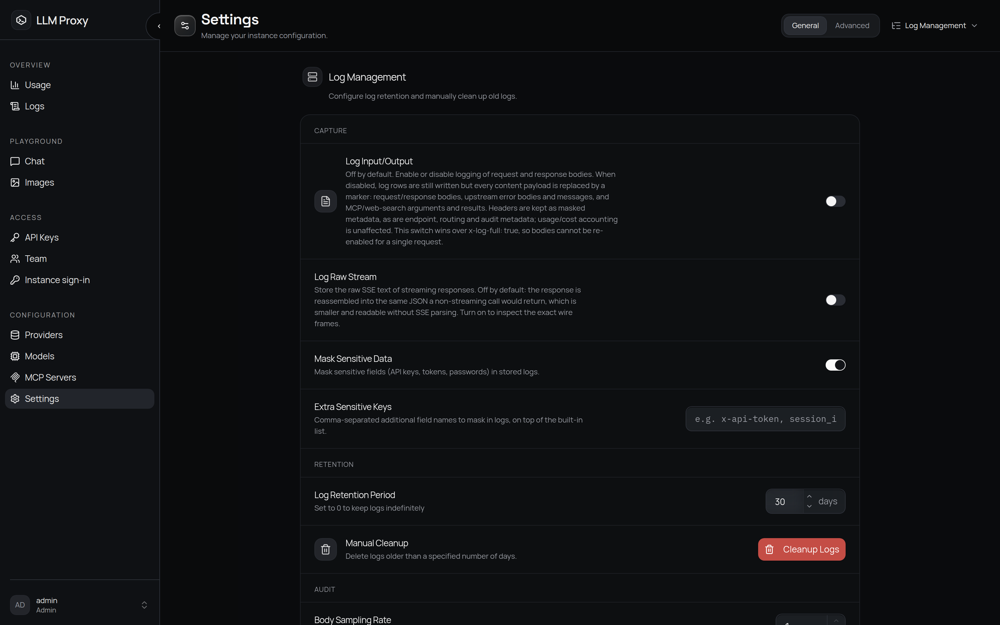
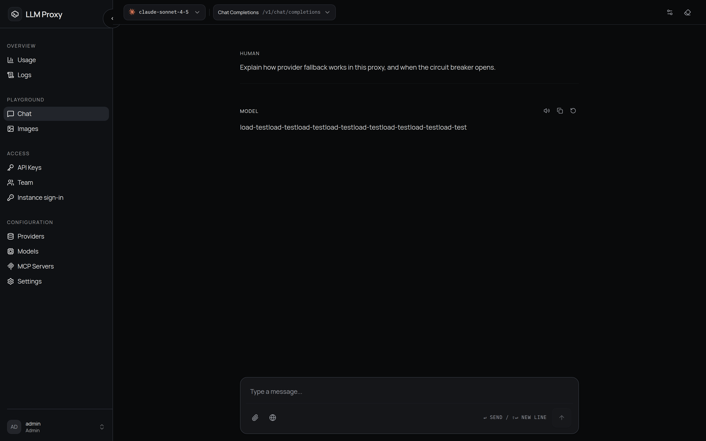

# 管理控制台总览

管理控制台是代理自带的一个 Vue 3 单页应用，浏览器打开
`http://localhost:8080`（或你的部署地址）即可。下面逐个介绍页面，每个配置页另有
详细文档。

## 登录

| 情况 | 你会看到 |
| --- | --- |
| 还没有任何账户 | **创建管理员账户**（`/setup`）——用户名由你决定，账户以 `admin` 角色创建 |
| 正常登录 | **登录 LLM Proxy**（`/login`） |
| 管理员创建了你的账户，或重置了你的密码 | **设置新密码**（`/force-change-password`）——改密之前其他页面都进不去 |

密码必须为 8–72 个字符，且至少包含一个大写字母、一个小写字母、一个数字和一个特殊
字符。登录失败按 IP 限流；账户锁定功能存在，但**默认关闭**（见
[服务器设置](/zh/admin/settings#security-rate-limiting)）。

::: info 两套不同的凭据
控制台登录用的是 JWT 会话，只对 `/api/*` 有效，存放在 `HttpOnly` Cookie 里。聊天和
图像游乐场调用 `/v1/*` 时，会用另一个 `HttpOnly` Cookie 里的短期*会话 API 密钥*；
页面脚本读不到这两种凭据。客户端流量要使用你在 **API 密钥** 页面创建的密钥，
见 [API 密钥](/zh/admin/api-keys)。
:::

## 每种角色能做什么

| 能力 | `admin` | `viewer` |
| --- | --- | --- |
| 使用统计面板 | 全部 | 仅自己的用量 |
| 日志 | 全部行、**审计日志**标签页、完整性校验 | 仅自己的行 |
| 模型页面 | 模型管理 | 只读目录 |
| 提供商、MCP 服务器、团队 | 完全控制 | 隐藏（API 返回 403） |
| API 密钥 | 自己的密钥，全部字段 | 自己的密钥；允许 MCP 白名单，无按密钥速率限制 |
| 账户速率限制 | 在团队页面按成员设置 | 强制执行，只读 |
| 设置 | 全部区段 | 隐藏（仅管理员） |
| 账户（个人资料、偏好、登录与安全） | 自己的 | 自己的 |
| 游乐场（聊天、图像） | 是 | 是 |

## 导航地图

| 页面 | 你可以做什么 |
| --- | --- |
| **使用统计**（`/`） | 花费、Token、成功率、首字时间 / 延迟、吞吐、缓存节省；趋势与提供商 / 模型拆分 |
| **日志**（`/logs`） | 查单个请求、审计轨迹、MCP 调用与网络搜索调用 |
| **模型**（`/models`） | 模型映射、能力标记、上下文长度、定价、元数据 / 定价同步 |
| **提供商**（`/config/providers`） | 添加和编辑上游、API 密钥、base URL、自定义请求头、端点覆盖 |
| **API 密钥**（`/config/api-keys`） | 给客户端建和管理密钥：预算、限制、白名单、过期 |
| **MCP 服务器**（`/config/mcp-servers`） | 接入 MCP 服务器（stdio 或 HTTP），把工具暴露给模型 |
| **团队**（`/team`） | 创建成员、分配角色、按成员的模型白名单、账户预算与速率限制 |
| **聊天**（`/chat`） | 游乐场：用流式、工具、视觉和推理测试任意模型 |
| **图像**（`/images`） | 游乐场：图像生成与编辑 |
| **实例登录**（`/config/console-auth`） | 实例级登录策略：公开 URL、SMTP 投递、OIDC 提供商、强制管理员双因素 |
| **设置**（`/config/settings`） | 日志、网络搜索以及全部服务器级策略区段——仅管理员 |
| **账户**（`/account`） | 你的身份：用户名、邮箱、角色、预算与当前会话 |
| **偏好**（`/account/preferences`） | 主题与语言（保存在本浏览器），以及你自己的追踪后端 |
| **登录与安全**（`/account/security`） | 通行密钥、密码、双因素、关联提供商与当前会话 |
| **关于**（设置 → 常规） | 版本与更新检查 |

## 日志标签页

| 标签页 | 内容 |
| --- | --- |
| **代理日志** | 每个请求一行：时间戳、密钥/用户、模型、提供商、状态、首字时间、耗时、Token、成本 |
| **审计日志** | 管理员操作与安全事件，带**校验完整性**（哈希链检查），仅管理员 |
| **MCP 调用** | MCP 服务器、操作、资源、状态、耗时 |
| **网页搜索** | 查询、提供商、结果数、状态、耗时 |

## 改动即时生效

提供商、模型、API 密钥、MCP、团队和设置页面上的改动都会写进数据库并立刻生效，
不需要重启；只有启动时读取的[环境变量](/zh/reference/environment)例外。

::: warning 破坏性操作
删除 API 密钥、提供商、MCP 服务器、模型或成员都无法撤销；设置 → 日志管理里的
**日志清理**会永久删掉早于指定时间的日志。这些操作执行前都会要求确认。
:::

配置实例时，先看[提供商](/zh/admin/providers)，然后是
[模型与定价](/zh/admin/models)，最后创建 [API 密钥](/zh/admin/api-keys)。
