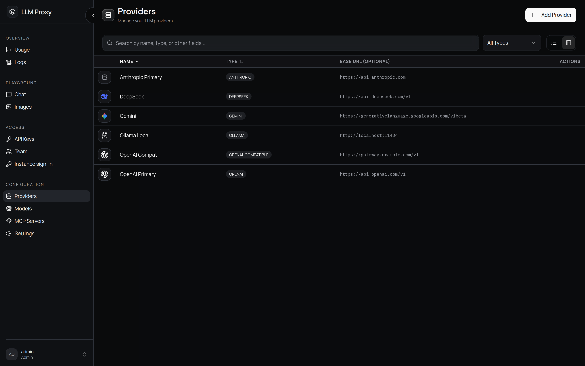

# 提供商

一个提供商就是一个上游端点加上它的凭据。提供商与客户端看到的模型名互不相干：你完全
可以添加多个提供同一个模型的提供商，由回退和优先级决定最终谁来应答。

## 添加提供商

**提供商 → 添加提供商**。填写以下字段：

| 字段 | 说明 |
| --- | --- |
| **名称** | 唯一标识，模型映射通过它来引用。不是厂商名——例如 `openai-prod` |
| **类型** | 内置适配器类型之一（见下表） |
| **API 密钥** | 多数类型必填；`ollama`、`vllm`、`sglang` 不需要（也不会使用） |
| **Base URL** | 按类型预填。`openai-compatible` **必填**。末尾的斜杠会被去掉 |
| **图标 URL** | 可选，显示在控制台提供商旁边的 logo；必须是公网 URL（`https:`/`http:`），私有地址和回环地址会被 SSRF 防护拒绝 |
| **Gemini Interactions** | 仅 `gemini` 类型：改用 Google 较新的 Interactions API，而不是 `generateContent`（`metadata.api_variant`）。提供商列表中会显示 **Interactions** 徽标 |
| **Gemini 模型系列覆盖** | 仅 `gemini` 类型，只能通过 API/数据库设置（`metadata.model_family_overrides`）：把精确的模型 id 映射到某个 Gemini 系列版本（例如 `{"gemini-flash-latest": "4.0"}`），作用于 generateContent 方言。当模型 id 里不含 `gemini-X.Y` 片段时（Google 的别名、聚合站的昵称）用它——否则代理会为该 id 回退到旧版安全的请求形态，并记录一次警告；设置之后，就按所钉系列的形态处理（思考等级与预算、JSON-Schema 字段、思考签名、采样参数丢弃）。取值必须是 `"4.0"`/`"3.8"` 这样的版本号；无效条目会被丢弃并给出警告。Interactions 方言没有系列门控，在那里钉版本不起作用 |
| **API 版本** | 不在控制台对话框中，只能通过 API/数据库设置。仅为向前兼容而存储——目前没有适配器应用它 |
| **超时** | 不在控制台对话框中，只能通过 API/数据库设置。会存储但不生效——上游调用固定使用 600 秒读超时（10 秒连接超时） |
| **自定义请求头** | 额外发送给上游的请求头（例如租户或组织标识头）。同名请求头以这里的值为准，优先于其他任何来源 |
| **应用归属** | 仅 `openrouter` 类型：应用 URL（`HTTP-Referer`）、名称、市场分类和榜单可见性。未填写的值会回退为归功于 LLM Proxy 项目 |
| **端点基础 URL** | 按端点覆盖；URL 原样使用，不会拼接端点路径 |
| **原生联网搜索** | 当上游自带联网搜索工具时设置；代理随后会直接透传 `web_search` 工具，不再自行拦截 |
| **优先级** | 控制台不显示；提供商级的 `priority` 只能通过 API/数据库设置，且在选择时被忽略——回退顺序来自每个**模型映射**的优先级（见[模型与定价](/zh/admin/models#provider-priority-and-fallback)） |

提供商 API 密钥在控制台中会做遮蔽——编辑对话框只显示一个遮蔽后的禁用字段。唯一能
读回密钥的方式是经过审计的 `POST /api/config/providers/{name}/api-key/reveal` 端点。
密钥在落盘时用 Fernet 加密（密钥由 `ENCRYPTION_KEY` 派生）；轮换该环境变量会让已存储
的密钥无法解密。

## 提供商类型

| 类型 | 上游协议 | 默认 Base URL |
| --- | --- | --- |
| `openai` | Chat Completions + Responses | `https://api.openai.com/v1` |
| `anthropic` | Anthropic Messages（`x-api-key`、`anthropic-version: 2023-06-01`） | `https://api.anthropic.com` |
| `openai-compatible` | Chat Completions（通用；**必须提供 base URL**） | — |
| `gemini` | Google `generateContent`（`x-goog-api-key`） | `https://generativelanguage.googleapis.com/v1beta` |
| `ollama` | 原生 Ollama（`/api/chat`、`/api/tags`）+ OpenAI 兼容语音（`/v1/audio/speech`） | `http://localhost:11434` |
| `vllm` | Chat Completions | `http://localhost:8000/v1` |
| `sglang` | Chat Completions | `http://localhost:30000/v1` |
| `deepseek` | Chat Completions + 原生 Anthropic/Responses | `https://api.deepseek.com/v1` |
| `xai` | Chat Completions + 原生 Responses | `https://api.x.ai/v1` |
| `zai` | Chat Completions（GLM 布局） | `https://api.z.ai/api/paas/v4` |
| `zai-coding` | Chat Completions + 原生 Anthropic/Responses | `https://api.z.ai/api/coding/paas/v4` |
| `zhipu` | Chat Completions + 原生 Anthropic | `https://open.bigmodel.cn/api/paas/v4` |
| `zhipu-coding` | Chat Completions + 原生 Anthropic/Responses | `https://open.bigmodel.cn/api/coding/paas/v4` |
| `moonshot` | Chat Completions + 原生 Anthropic | `https://api.moonshot.ai/v1` |
| `kimi-code` | Chat Completions + 原生 Anthropic | `https://api.kimi.com/coding/v1` |
| `minimax` | Chat Completions + 原生 Anthropic/Responses | `https://api.minimax.io/v1` |
| `qwen` | Chat Completions + 原生 Anthropic/Responses | `https://dashscope.aliyuncs.com/compatible-mode/v1` |
| `qwen-intl` | 与 `qwen` 相同（国际版密钥绑定区域） | `https://dashscope-intl.aliyuncs.com/compatible-mode/v1` |
| `openrouter` | Chat Completions + 原生 Responses | `https://openrouter.ai/api/v1` |
| `chutes` | Chat Completions | `https://llm.chutes.ai/v1` |
| `mistral` | Chat Completions | `https://api.mistral.ai/v1` |
| `cohere` | 原生 Cohere v2（`/v2/chat`、`/v2/embed`、`/v2/rerank`、`/v2/audio/transcriptions`） | `https://api.cohere.com` |
| `nanogpt` | Chat Completions | `https://nano-gpt.com/api/v1` |
| `opencode-zen` | 按模型选择方言：Chat Completions / Anthropic / Responses / Google / System One（见下文） | `https://opencode.ai/inference` |
| `opencode-go` | 同一网关，订阅线路（自有模型目录） | `https://opencode.ai/inference/go` |

**原生协议**指：当客户端使用的协议与上游一致时，代理可以把请求*原样*转发给该上游
（Anthropic 客户端打到原生 Anthropic 提供商，Responses 客户端打到原生 Responses
提供商），从而保留翻译层本来会规整掉的字段。`vllm`/`sglang` 需要按提供商打开提供商
元数据 `native_passthrough: true` 才会启用。

成本上报：`openrouter` 和 `nanogpt` 会返回自己的成本数字，代理直接记录这些数字，而不是
按 Token 价格自行计算。

### OpenCode（`opencode-zen` / `opencode-go`）

这个网关请使用专用的 `opencode-zen` / `opencode-go` 提供商类型：把通用的
`openai-compatible` 提供商指向 `opencode.ai` 不会带上下面说的网关身份头和会话头。

OpenCode 网关背后是多个模型系列，它们各自的上游协议并不相同。一个请求走哪种方言是
**模型**的属性，按以下顺序逐请求解析：学习到的纠正（见下文）、models.dev 目录
（OpenCode 团队自己维护的按模型 `provider.npm` 数据，带 6 小时 TTL 缓存——新的模型
系列无需改代码就能路由正确）、接着是模型 id 前缀启发式（默认 Chat Completions）。
Claude 模型走 Anthropic Messages，GPT/Grok 走 OpenAI Responses，Gemini 走
generateContent，Jev 走 System One（仅 `/v1/systemone` 端点——Jev 模型的聊天请求会被
拒绝，并指向那里），其余全部走 Chat Completions。

- 类型即线路：`opencode-zen` 是 Console 按量付费线路
  （`https://opencode.ai/inference`），`opencode-go` 是订阅线路
  （`https://opencode.ai/inference/go`）——两条线路提供不同的模型目录（同一个 id 在
  两条线路上甚至可能使用不同方言；适配器读取的是所属线路在 models.dev 的条目）。每条
  线路的根路径下，每一种 wire 方言各占一段：Chat Completions 与 Responses 用
  `/openai/v1`，Messages 用 `/anthropic/v1`，Gemini 用 `/google/v1beta`，System One 用
  `/systemone/v1`；模型列表在 `<root>/v1/models`。旧的扁平根路径仍可通过把 `base_url`
  设为 `https://opencode.ai/zen/v1` 或 `https://opencode.ai/zen/go/v1` 使用（所有方言都
  在 base URL 下）；更早的 Console 根路径 `https://opencode.ai/inference/v1` 则把
  Chat Completions 留在 base、其余方言带各自的段前缀。见
  [ADR-0055](https://github.com/zwldarren/llm-proxy/blob/main/docs/adr/0055-opencode-v2-lane-roots.md)。
- 请求头：统一使用 `Authorization: Bearer`，另外在网关会读取授权头的方言上再加该
  方言的头（Anthropic 路由用 `x-api-key`，Google 路由用 `x-goog-api-key`）。身份头
  （`x-opencode-client`、`x-opencode-project`、按会话固定的 `x-opencode-session`、
  每次请求新生成的 `x-opencode-request`）默认都会发送。Zen 线路保留
  `User-Agent: opencode/...`，因为它的免费额度以该身份为门槛；Go 线路发送
  `User-Agent: llm-proxy/<version>`，这是 Go 文档要求客户端自报身份的做法。以上任何
  一个都可以通过**自定义请求头**替换，包括替换为空值。
- 会话亲和：`x-opencode-session` 是*对话*稳定的上游 id，不是每次请求的随机值：
  OpenCode 据此把一个对话固定到同一后端并复用它提示缓存。客户端自己发了会话头时，
  代理采用它（`x-opencode-session`，或原生的 `x-claude-code-session-id`、Codex 的
  `session_id` / `thread-id`、Pi 的 `x-session-affinity`、DeepSeek Harness 的
  `x-deepseek-harness-session-id`、Goose 的 `agent-session-id`、Amp 的
  `x-amp-thread-id` 形式）；否则取请求体中显式的 `session_id` /
  `conversation_id` / `thread_id`，再否则取 Anthropic 的 `metadata.user_id` 会话或
  `prompt_cache_key`，最后取第一条真实用户消息的确定性指纹。Copilot 风格的
  `<environment_info>` / `<context>` 块即使出现在同一条消息的提示前面也会被剥掉。只有
  以上都不存在时才新生成一个 id。代理只会转发携带最终 id 的那个原生头（如果 id 来自
  Codex，还会加上它的 `x-codex-turn-metadata`），因此客户端互相冲突的写法不会让边缘
  选择另一个对话。想要刻意固定一个 id，可以在**自定义请求头**里设置
  `x-opencode-session`（这会关闭按对话的亲和行为）。见
  [ADR-0052](https://github.com/zwldarren/llm-proxy/blob/main/docs/adr/0052-opencode-session-affinity.md)
  与
  [ADR-0056](https://github.com/zwldarren/llm-proxy/blob/main/docs/adr/0056-goose-and-amp-session-headers.md)。
- 自愈：当网关以带模型语义的 400/404 拒绝某个模型时，请求会在其余方言上重试
  （优先 Chat Completions），并在进程存活期内记住可用的方言。
- 模型列表：网关的 `/v1/models` 只返回裸 id；显示名、上下文窗口和定价从
  models.dev 目录补充。把提供商元数据 `opencode_catalog_url` 设为一个镜像可钉住目录，
  设为空值则关闭它（此时由启发式承担路由）。

### OpenRouter 专属说明

OpenRouter 是一个路由器，而不是单个上游，因此适配器会保留它的一些请求形态：

- Responses 与 Messages 透传。 `/v1/responses` 和 `/v1/messages` 客户端会被原样
  转发，因此 `reasoning.mode` / `reasoning.context`、`thinking` 预算、
  `context_management`、`provider` 路由偏好、`plugins`、`models` 回退和 `usage`
  计量都能到达 OpenRouter。Anthropic 协议的客户端因此避免了
  （Messages → Chat Completions → Messages）这种过去会丢字段的双重翻译。Chat
  Completions 客户端则通过请求构建器拿到等价字段。把提供商元数据
  `native_passthrough: false` 可回退到 Chat Completions 翻译（例如被路由到的模型
  不接受某个只属于 Responses 的条目类型时）。
- 统一的 `reasoning` 对象。 代理发送的是 `reasoning: {effort, mode, context,
  summary, max_tokens, exclude, enabled}`，而不是裸的 `reasoning_effort`，因为
  `mode: "pro"`（以及其他只属于 Responses 的字段）在顶层没有等价物。OpenRouter 只在
  能路由到 OpenAI 或 Azure 时、且仅对 GPT-5.6 及更新模型才认 `mode: "pro"`。
- 应用归属。 提供商对话框里的**应用归属**字段用于在 OpenRouter 榜单上标识你的
  部署：应用 URL（`HTTP-Referer`）、显示名（`X-OpenRouter-Title`）、市场分类，以及
  新建应用是否公开列出。未填写的字段会回退为归功于 LLM Proxy 项目；在**自定义请求头**
  里显式设置的请求头优先于这两者。取值会校验为可打印 ASCII（它们会成为原始 HTTP
  请求头），URL 必须是绝对 http(s) URL，分类最多接受两个。
- 转发的客户端请求头。 按请求生效的 OpenRouter 控制头
  （`X-OpenRouter-Metadata`、`X-OpenRouter-Cache`、`X-OpenRouter-Cache-TTL`、
  `X-OpenRouter-Cache-Clear`）会从客户端转发，`x-session-id`（聊天上的粘性路由与提示
  缓存亲和；在 embedding/图像/音频端点上它是挂会话的唯一方式，在那里用于用量归组）
  和 `x-anthropic-beta`（Claude beta 选项，例如 `structured-outputs-2025-11-13`，
  不传的话 OpenRouter 会从工具定义里去掉 `strict`）同样转发。客户端 Codex / Claude
  Code 的指纹头*不会*转发给路由器。
- 按端点的透传字段。 每个端点都保留 OpenRouter 在 OpenAI schema 之外还文档化的
  字段：聊天（`provider`、`models`、`plugins`、`session_id`、`trace`、`preset`、
  `structured_outputs`、`cache_control`、`min_p`、`top_k`、`top_a`、
  `repetition_penalty`）、embedding（`input_type`、`session_id`、`trace`、
  `provider`、`user`）、图像生成（`resolution`、`aspect_ratio`、`seed`、
  `input_references`、`provider`）、TTS（`input_references`、`provider`）和 STT
  （`provider`）。聊天还会为仍在使用旧字段的客户端转发 `route`、`transforms`、
  `usage` 和 `include_reasoning`——上游已分别用 `providers.sort.partition`、
  `context-compression` 插件、`stream_options.include_usage` 和
  `reasoning.exclude` 取代它们。图像请求会被规整为 Image API 自己的 schema
  （`output_format`、`background`、`output_compression`；`response_format` 和
  `style` 被丢弃），TTS/STT 的 `response_format` 会按 OpenRouter 接受的格式校验
  （`mp3`/`pcm` 与 `json`/`verbose_json`），而不是把上游的 400 透出去。
- 响应元数据。 `X-Generation-Id`（可配合
  `GET /api/v1/generation?id=` 使用）和 `X-OpenRouter-Cache-*` 头会转发给客户端；
  `usage` 里的 `cost`、`cost_details` 和 `is_byok` 用于生成成本记录。
- 模型选择器。 提供商的目录以 `output_modalities=all` 抓取：上游默认是 `text`，
  那会隐藏这个适配器同样服务的图像、视频、音频和 embedding 模型——并保留目录里的
  `context_length`、模态、`supported_parameters` 和定价，好让选择器能显示哪些模型不是
  纯文本、以及它们的价格。
- 音频。 语音（`mp3`/`pcm`）和转写（`json`/`verbose_json`）格式在代理边界就校验，
  而不是把上游 400 透出去。OpenRouter 没有音频*翻译*端点，因此
  `/v1/audio/translations` 在本地就被拒绝，而不是让上游返回 404。
- 模型变体。 `:free`、`:nitro`、`:floor`、`:online`、`:thinking` 以及 `*-pro`
  变体都作为普通模型字符串透传，但模型查找是精确名称匹配——想暴露哪个变体就把它注册成
  独立模型，或者用模型别名路由到它。

### Qwen（Model Studio / DashScope）专属说明

两种提供商类型覆盖按区域划分的 DashScope 域名：`qwen`（北京，
`dashscope.aliyuncs.com`）和 `qwen-intl`（新加坡，
`dashscope-intl.aliyuncs.com`）。API 密钥绑定区域，国际版密钥只能用于 `qwen-intl`，
反之亦然。业务空间专属域名
（`https://{WorkspaceId}.cn-beijing.maas.aliyuncs.com/…`）通过提供商的 **Base URL**
字段使用。

- 原生协议。 Anthropic Messages（`{host}/apps/anthropic/v1/messages`）和 OpenAI
  Responses（`{base_url}/responses`）会被原样转发，因此 Claude Code 的请求形态、
  `cache_control` 断点和 Responses 条目原封不动到达 DashScope。Anthropic 端点只暴露
  `/v1/messages`——没有模型列表端点，所以探测 `/v1/models` 的客户端会看到上游的 404。
- 聊天厂商字段。 未识别的聊天字段会透传给 DashScope，因此客户端可以在
  `extra_body` 里使用 `enable_thinking`、`thinking_budget`、`enable_search`、
  `search_options`、`tool_stream` 和 `enable_code_interpreter`。
- 图像。 Wan 和 Qwen-Image 都走 DashScope 的异步任务 API。DashScope 的图像扩展
  字段被接受并平铺在请求体里转发：`image`（URL / base64 / 数组，会把调用变成图生图）、
  `negative_prompt`、`seed`、`prompt_extend`、`prompt_extend_mode`、
  `enable_thinking`、`watermark`，编辑时还有 `bbox_list`、`color_palette`、
  `enable_sequential`、`thinking_mode`。这里没有遮罩的概念——请改传 `bbox_list`。
- Embedding。 `text-embedding-v1..v4` 和 `qwen3.7-text-embedding` 走
  `{base_url}/embeddings`。`dimensions` 会按 DashScope 文档给出的取值集合校验，单请求
  行数上限（`qwen3.7-text-embedding` 为 20，v3/v4 为 10，v1/v2 为 25）在代理侧强制
  执行。
- 没有音频。 DashScope 没有 OpenAI 兼容的音频接口。语音合成（Qwen-TTS、
  CosyVoice）使用原生的
  `/api/v1/services/aigc/multimodal-generation/generation` 端点，OpenAI 兼容的 ASR
  （`qwen3-asr-flash`）则是带 `input_audio` 内容片段的 `/chat/completions`。对 qwen
  提供商请求 `/v1/audio/*` 会返回 `400`。
- 联网搜索。 DashScope 的 Responses API 自带 `web_search` / `web_extractor` /
  `code_interpreter` 工具。设置提供商元数据 `native_web_search: true` 让 `web_search`
  工具直接到达它；否则代理会拦截并运行自己的联网搜索。在 Chat Completions 上，代理会
  发出 `enable_search: true` 使用托管搜索；`search_options` 有意保持 DashScope 的默认
  值，因为 `search_strategy: agent` 会被本代理服务的模型拒绝，而 `freshness` /
  `assigned_site_list` 只对 `qwen-plus` / `qwen-flash` 生效。在
  **Anthropic 兼容**端点上，DashScope 只有在请求同时带有它的计费头（`system` 块中含
  `x-anthropic-billing-header: cc_entrypoint=cli;`）时才运行服务端工具——没有它，
  `web_search_20250305` 会被接受但在上游被忽略。

### DeepSeek 专属说明

DeepSeek 在同一主机上提供三种协议：Chat Completions
（`https://api.deepseek.com/v1`）、Anthropic Messages 端点
（`https://api.deepseek.com/anthropic/v1/messages`）和 OpenAI Responses 端点
（`https://api.deepseek.com/responses`）。适配器推导这两个原生端点时会去掉 `/v1`
兼容别名。

- 原生联网搜索。 DeepSeek **只在 Responses 端点上、在服务端**运行 `web_search`，
  而且只对 `deepseek-v4-pro`（`deepseek-flash` 接受该工具但静默忽略）。声明方式与
  OpenAI 一样——`"tools": [{"type": "web_search"}]`，或 DeepSeek 带日期的写法
  `{"type": "web_search_2025_08_26"}`——并把提供商元数据 `native_web_search: true`
  设上，否则代理会拦截该工具并自己跑搜索。代理原样转发请求体，把
  `response.web_search_call.*` 流式事件透传出去，并把 `web_search_call` 输出条目带回
  给客户端，因此下一轮可以把它们作为 `input` 发回，由 DeepSeek 恢复结果。Chat
  Completions 完全没有联网搜索——在那里的 `web_search` 工具只有通过代理侧拦截才有用。
- Anthropic 端点兼容内容块，但不兼容服务端工具。 `server_tool_use` 和
  `web_search_tool_result` 块会被接受（重放时能保留），但 DeepSeek 文档化的内置工具
  列表止于 `function`，所以不要指望 `web_search_20250305` 在那里被执行。
- 无状态 Responses。 没有 `previous_response_id`：代理会把已存储的一轮实体化为
  `input` 条目，并对该轮回退到 Chat Completions 翻译，这也是实体化续写无法使用服务端
  `web_search` 的原因。

### MiniMax 专属说明

MiniMax 提供 Chat Completions（`https://api.minimax.io/v1/chat/completions`）、
Anthropic 兼容的 Messages 端点（`https://api.minimax.io/anthropic/v1/messages`）和
OpenAI Responses 端点（`https://api.minimax.io/v1/responses`）。两个原生端点原样转发，
因此客户端自己的字段能保留下来。

- 思考词汇会被翻译。 MiniMax 不说 Anthropic 那套：`thinking.type` 是 `disabled`
  或 `adaptive`（没有 `budget_tokens`），深度走 `reasoning_effort`（Chat）或
  `output_config.effort`（Messages），并且 `none` / `minimal` 不是它接受的写法——它会
  返回 HTTP 400。因此代理在每一层都重写这套词汇：Anthropic 客户端的
  `thinking: {"type": "enabled", "budget_tokens": 16000}` 会变成
  `{"type": "adaptive"}`，`minimal` 的力度变成 `low`，「不推理」会变成
  `thinking: {"type": "disabled"}` 而不是 `reasoning_effort: "none"`。
  `MiniMax-M3.1-Flash` 总是思考，连 `disabled` 也拒绝，所以在该模型上这个字段会被
  直接丢弃。
- `reasoning_split` 是 MiniMax 自己的输出开关：关掉它时，思考内容仍留在 `content`
  里、用 ` thinking` 标签包裹，而不移到 `reasoning_content`。它会随聊天请求转发。
- 视频输入。 M 系列模型能读图像和视频。OpenAI 聊天请求用 `video_url`；
  Anthropic 兼容的 Messages 端点用 `video` 块，代理把它解析成共享的视频块，并在聊天
  请求上渲染为 `video_url`。
- 服务层级会被翻译。 MiniMax 把层级叫 `standard` 和 `priority`（priority 层级贵
  1.5 倍，换取优先接入；`MiniMax-M3.1-Flash` 不支持该字段）。客户端说的是别的词——
  Anthropic 的 `auto`/`standard_only`，OpenAI 的 `auto`/`default`/`flex`/`priority`
  ——所以代理做映射：`standard_only`/`default` 变为 `standard`，`priority` 保持不变，
  而 MiniMax 没有对应词的层级（`auto`、`flex`）会被丢弃，而不是作为非法枚举值发送。
- 错误放在响应体里。 Chat Completions 端点返回 HTTP 200，把失败放在
  `base_resp.status_code`（1002 速率限制，1004 认证，1008 余额，1026/1027 敏感内容，
  2013 参数无效，……）。代理会把这些转成标准 HTTP 错误（429/401/402/400），而不是
  一个空的成功响应。Messages 和 Responses 端点使用常规 HTTP 状态码，无需翻译。
- Token 计数。 MiniMax 提供两个计数器：Anthropic 兼容的
  `POST /anthropic/v1/messages/count_tokens`（挂在
  `POST /v1/messages/count_tokens` 后面）和 `POST /v1/responses/input_tokens`（挂在
  `POST /v1/responses/input_tokens` 后面）。两者都转发到上游，因此数字是 MiniMax
  自己的，而不是本地估算。

### Cohere 专属说明

`cohere` 类型从 API 根（`https://api.cohere.com`）说 Cohere 的**原生 v2 API**：
`POST /v2/chat`、`/v2/embed`、`/v2/rerank` 和 `/v2/audio/transcriptions`。每一轮都会被
翻译——Cohere 没有发布 Anthropic Messages，也没有 OpenAI Responses 端点，所以这个类型
没有原生透传层。

Cohere 的*兼容*接口（`https://api.cohere.ai/compatibility/v1`）被有意弃用：它是
OpenAI 形状的投影，会丢掉本适配器保留的 Cohere 专属字段，并拒绝代理本来会转发的
OpenAI 字段。

- 聊天消息。 v2 有 `system`/`user`/`assistant`/`tool` 角色，并且只有一个位于开头
  的 system 槽位，因此每个 system 和 developer 轮次（包括对话中途出现的）都会被合并进
  那条消息，用空行连接。工具输出成为单独的 `role: "tool"` 消息，以 `tool_call_id`
  为键。内容是纯字符串或 `text`/`image_url` 块；客户端以字节发送的图像会以 `data:`
  URI 到达。
- 采样。 `top_p` → `p`，`stop` → `stop_sequences`（v2 最多承认五个，其余丢弃并
  给出警告），`temperature`、`max_tokens`、`frequency_penalty`、`presence_penalty`、
  `seed` 一一对应。**`n > 1` 被拒绝**：v2 每个请求只返回一个补全，拆成多次调用会让
  计费请求翻倍。
- 结构化输出。 OpenAI 的 `{"type": "json_schema", "json_schema": {name,
  schema, strict}}` 变成 v2 的 `{"type": "json_object", "json_schema": <schema>}`；
  Cohere 没有 strict 标志。v2 文档说明 `response_format` 不能与 `documents` 或
  `tools` 同时使用——二者只能取其一。
- 思考。 统一的 `thinking` 配置变成 v2 的
  `{"type": "enabled"|"disabled", "token_budget": N}`。对支持推理的模型，推理默认
  开启；`disabled`（或力度为 `none`/`minimal`）会发送关闭的写法，而不是省略字段。
- 工具。 工具是 JSON-Schema 函数条目（`parameters` 必填，所以没有 schema 的工具
  会得到 `{}`），自由形式工具会桥接成单 `content` 函数。`tool_choice` 收缩到 v2 的
  `REQUIRED`/`NONE` 二选一：v2 没有「调用*这个*工具」的模式，所以具名选择会变成
  `REQUIRED`，而 `auto` 通过省略字段来表示。托管工具在这条请求上没有位置，会被丢弃
  并说明原因。
- Cohere 专属字段。 `documents`、`citation_options`、`safety_mode`、
  `strict_tools`、`priority`、`k` 和 `logprobs` 通过 `extra` 透传，不受未知字段策略
  约束。Cohere 在 RAG 回答中返回的引用会附带在它所引用的文本块上（`content_index`）。
- Embedding。 v2 要求 `input_type`：默认 `search_document`；要
  `search_query`/`classification`/`clustering`/`image` 请传 `extra.input_type`——并按
  embedding 类型分组返回向量。`dimensions` → `output_dimension`，
  `encoding_format: "base64"` → `embedding_types: ["base64"]`。超过 Cohere 96 条输入
  上限的批量会被拒绝，而不是静默拆分。
- Rerank。 v2 接受纯字符串文档，且不回传任何文档，所以代理会把请求本身的文档投影
  到排序结果上（除非客户端只要求索引和分数）。只有图像的文档在 v2 没有表示形式，会被
  拒绝。`max_tokens_per_doc`、`relevant_spans` 和 `priority` 通过 `extra` 透传。
- 音频。 `/v2/audio/transcriptions` 要求 `language`（ISO-639-1）：Cohere 没有自动
  检测——而 `prompt`、`response_format`、时间戳粒度和 `include` 在 v2 没有等价物，因此
  会被丢弃，客户端自己的响应格式由代理来满足。这里没有流式转写、没有 TTS，也没有音频
  翻译。
- 模型列表。 `GET /v1/models`（Cohere 没有文档化 `/v2/models`），使用自己的
  `page_size`/`page_token` 分页，而不是 OpenAI 风格的分页 Token。

### Gemini 专属说明

`gemini` 提供商类型默认走 `generateContent`，把 `metadata.api_variant` 设成接口方言后走
Interactions API。上游接受哪种请求形状由模型版本决定（见上文表格里模型家族覆盖那一行）。

- 会被丢弃的参数：`n > 1`（对应 `candidateCount`）和 `logprobs` / `top_logprobs`
  （对应 `responseLogprobs` / `logprobs`）不会发往上游，日志里会点名它们。当前可用的模型
  对上这两组字段都直接返回 400（"Multiple candidates is not enabled for this model"、
  "Logprobs is not enabled for this model"）。客户端仍然会拿到正常的单候选回答。
- 结构化输出：`response_format: {"type": "json_schema", …}` 在 Gemini 3 及以后映射为
  `generationConfig.responseFormat.text`，传完整 JSON Schema（`$ref`、`oneOf`、
  `additionalProperties` 都保留）；更早的家族用清洗后的 `responseMimeType` +
  `responseSchema`。格式成员里的 MIME 字段要填枚举值 `APPLICATION_JSON`，字符串
  `application/json` 只在旧的 `responseMimeType` 和 Interactions API 上有效。
- Gemini 原生字段：`generationConfig`、`cachedContent`、`safetySettings` 这些字段在客户端
  协议上没有入口。用模型映射的 `parameter_overrides` 注入：代理注入的键不受未知字段策略
  约束，会进入发往上游的 body。注入的 `generationConfig` 会整体替换代理构建的那一份，
  所以要把这次请求需要的字段都写全。
- 批量模式：`models/{model}:batchGenerateContent` 已通过 OpenAI 兼容的批量接口代理
  （见[批量模式](/zh/api/batch)）：代理把作业里的请求内联发给 Gemini，受其 20 MB 上限
  约束；提供商配置成 `api_variant: "interactions"` 时批量会被拒绝。若想改在请求链路上拿
  同样的 50% 折扣，用 `service_tier: "flex"`。

## 联网搜索：原生还是代理侧

能应答 `web_search` 工具的机制有两套，每个请求只会运行其中一套：

- 代理侧（默认）。 在**设置 → 常规 → 网络搜索**里配置了搜索提供商（SearXNG 或 Ollama）
  后，代理会把托管工具改写为普通函数工具，自己执行搜索，并以 Anthropic 兼容的形态
  注入结果。这对所有提供商都有效，包括根本没有托管搜索的纯 Chat Completions 上游。
- 原生（按提供商）。 打开提供商的**使用原生联网搜索**（提供商元数据
  `native_web_search: true`），让上游自己执行该工具。这时代理会按该上游自己的形态
  转发工具声明——包括在 Chat Completions 请求上，那里形态往往根本不是 `tools[]` 条目
  （Qwen 的 `enable_search`、NanoGPT 的 `web_search` 请求体对象、Z.ai 的
  `web_search.search_engine`）——并且只转发它产生的结果。

默认走代理侧，是因为托管声明表示「替我搜索」，客户端无法自己执行它。两者都配置时，
以该开关为准。

托管声明通常绝不会以 `function_call` 的形式返回：如果选中的上游在它所说的协议上没有
文档化的服务端搜索，代理会**丢弃该工具并警告说明原因**，而不是交给客户端一个它从未
声明过的函数。唯一的例外是代理完全没有对应方言的 Chat Completions 上游（自定义的
`openai-compatible` 端点），那里仍以方言出现之前的函数桥接作为回退——任何 Chat
Completions 请求都接受函数。按协议的具体规则见[托管工具](#hosted-tools)。

### 哪些上游真的会搜索

| 提供商 | 原生服务端搜索 | 通过什么到达上游 |
|---|---|---|
| `openai` | Responses `web_search`；Chat `web_search_options`（搜索模型） | 任意客户端协议（经翻译） |
| `anthropic` | `web_search_20260318` / `20260209` / `20250305` 服务端工具 | Messages（原样）、Chat `web_search_options`，或任何声明了 `web_search` 的客户端 |
| `gemini` | `google_search` grounding（`url_context` / `google_maps` 是独立工具） | 任意客户端协议 |
| `deepseek` | Responses `web_search`（仅 `deepseek-v4-pro`；见上文） | Responses（原样） |
| `xai` | Responses `web_search`（`filters.allowed_domains` / `filters.excluded_domains`）和 `x_search` | Responses（原样） |
| `qwen`、`qwen-intl` | Responses `web_search` / `web_extractor`（裸对象；extractor 需要搜索）；Chat `enable_search` + `search_options`；Anthropic 服务端工具 | Responses 与 Anthropic（原样），客户端发送 `enable_search` 时的 Chat |
| `openrouter` | 服务端工具 `openrouter:web_search`（`parameters.*`）；Responses 会把普通 `web_search` 提升为它 | Responses 与 Messages（原样），客户端发送服务端工具类型或旧 `plugins: [{"id": "web"}]`（已废弃）时的 Chat |
| `zai`、`zai-coding` | Chat `{"type": "web_search", "web_search": {"search_engine": ...}}`（`search_engine` 必填；API 参考只列出 `search_pro_jina`） | Chat Completions（原样） |
| `zhipu`、`zhipu-coding` | 相同的 Chat 形态（`search_engine`：`search_std` / `search_pro` / `search_pro_sogou` / `search_pro_quark`）；Responses `{"type": "web_search"}` | Chat（原样） |
| `minimax` | Responses `{"type": "web_search"}`；Anthropic `{"type": "web_search_20250305", "name": "web_search"}` | Responses 与 Messages（原样）；Chat **没有**服务端工具 |
| `nanogpt` | Responses `web_search`；Chat 请求体 `web_search: {"enabled": true, ...}`（NanoGPT 自己跑搜索；形态转录自 NanoGPT 公开的 API 说明——无法对照公开参考文档验证） | Responses（原样）、Chat 请求体字段 |
| `moonshot` | Responses `{"type": "web_search"}`；Chat `$web_search`（`type: "builtin_function"`，**已废弃——2026-10-20 停用**，改用上游 `/v1/tools/search`） | Chat（`$web_search`，旧式）——Messages 端点只接受客户端工具 |
| `mistral` | Chat Completions 上没有——`web_search` / `web_search_premium` 只为 **Agents / Conversations** API 文档化，且文档警告 Chat Completions「不受支持」 | 仅代理侧 |
| `vllm`、`sglang`、`ollama`、`chutes`、`cohere`、`opencode-zen`、`opencode-go` | 没有（Ollama 的联网搜索是独立的 `POST /api/web_search`，不是聊天功能；v2 聊天没有连接器） | 仅代理侧 |

一个托管工具，多种写法：代理会把 Anthropic 的 `web_search_20250305` 系列、OpenAI 的
`web_search` / `web_search_preview`、带日期的变体（`web_search_2025_08_26`）以及
OpenAI 聊天字段 `web_search_options` 统一成所选提供商协议能消费的形态，因此客户端
不需要知道自己被路由到了哪个上游。声明的 `web_search` *函数*工具总是优先于
`web_search_options`——那要么是客户端自己在跑搜索，要么是代理自己的拦截桥接，再声明
一次会搜索两遍。

提供商专属的托管工具会被承载，而不是翻译掉。声明在两种协议上都能通过入口，并到达
文档化它的那个协议；在没有对应协议的请求上，它会被丢弃并给出指出工具名的警告：

### 托管工具 {#hosted-tools}

| 声明 | 转发到 | 在其他所有地方（带警告）丢弃 |
|---|---|---|
| `google_search` / `google_search_retrieval` | Gemini（`{"google_search": {}}`） | 是 |
| `url_context`、`google_maps` | Gemini（裸工具键） | 是 |
| `code_execution`（Anthropic）/ `code_interpreter`（OpenAI） | Gemini（`{"code_execution": {}}`，由 Gemini 自己运行代码）；原生 Responses 请求 | 是 |
| `computer_use`、`file_search`（Gemini 自己的） | Gemini（`computer_use` 默认取文档化的 `ENVIRONMENT_BROWSER`，除非客户端指定；`file_search` 需要 `fileSearchStoreNames`，否则被丢弃） | 是 |
| `x_search`（+ `allowed_x_handles`、日期范围、图像/视频标志） | xAI Responses（原样） | 是 |
| `web_extractor` | Qwen Responses（原样；Qwen 要求同时带上 `web_search`） | 是 |
| `retrieval`（`knowledge_id`） | Z.ai / BigModel Chat Completions | 是 |
| `$web_search`（`type: "builtin_function"`） | Kimi Chat Completions——只因为客户端要求才转发；代理从不自行生成（上游已废弃，2026-10-20 停用） | 是 |
| `file_search`（OpenAI，`vector_store_ids`） | 支持它们的原生 Responses 请求 | 是——Gemini 的文件搜索读的是 *Gemini* 的文件搜索存储，因此 OpenAI 的向量存储 id 不会被翻译 |
| 代理从未见过的任何工具 | Responses 或 Gemini 请求（它们的 `tools[]` 联合是开放的），原样 | 在聊天请求上丢弃 |

在 Gemini 3+ 模型上，把内置工具与函数声明混用会打开
`toolConfig.includeServerSideToolInvocations`，正是它让 Gemini 把内置工具的调用和
结果与对话共享（ADR-0039）。

有两处刻意的非对称，均记录于 ADR-0038：

- 代理**没有对应方言**的上游（自定义 `openai-compatible` 端点、尚未建模的聚合站）保持
  旧行为：聊天请求得到 `web_search` 函数桥接，Responses 请求原样收到客户端的声明。
  未知不等于不支持。
- 代理侧拦截默认仍然优先。打开**使用原生联网搜索**，托管声明才会进入上面这些表；
  关着的时候，代理会用自己执行的函数桥接替换该工具。

## 验证提供商

- `GET /api/config/providers/{name}/models` 会查询上游模型列表：它同时就是有效的连通性
  检查。控制台在模型编辑器的提供商模型选择器中调用它（选择器里的 ↻ 按钮刷新列表）。
  `ollama`、`vllm` 和 `sglang` 做这一步不需要 API 密钥，其他类型都需要。
- 有了模型映射之后，从**聊天游乐场**或 `curl` 发一个测试请求，然后在
  [日志](/zh/admin/observability)里确认那一行。

## 已知限制

以下限制是刻意写出来的，免得你去追查它们：

- 提供商的 `timeout`、`api_version` 和 `rate_limit` 不会生效于请求路径。上游调用
  固定使用 600 秒读超时（10 秒连接超时）；速率限制是全局或按密钥的，不按提供商。
- 提供商的 `priority` 不影响选择：请改为在每个模型 → 提供商映射上设置优先级。
- 提供商的 `enabled` 不会过滤流量；要让某个提供商退出轮转，请删掉它的模型映射
  （或提高另一个提供商映射的优先级）。
- Gemini **没有 vertex/region/project 字段**，也没有 OAuth 流程。需要客户端指纹头的
  上游只能通过原生透传工作。
- 没有按提供商的健康检查；熔断器是唯一的自动保护。

## 相关

- [模型与定价](/zh/admin/models)：把客户端看到的名字映射到这个提供商
- [服务器设置](/zh/admin/settings#retry-fallback)：重试、回退、熔断器
