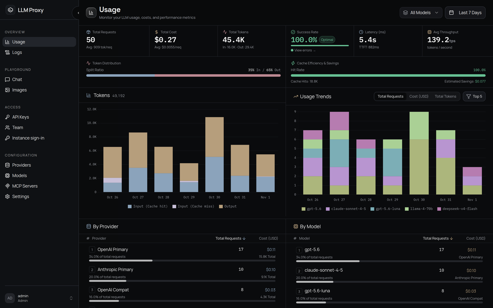

LLM Proxy 是一个可自托管的 LLM API 网关。把现有的 OpenAI 或 Anthropic SDK 指向它
（或者把 Cohere SDK 指向 rerank 端点），网关会把请求发给实际提供该模型的上游，再把
响应翻译回来。回退、成本感知路由、预算、请求日志和控制台都内置，修改配置不需要重启。



## 工作原理

```text
客户端                      LLM Proxy                                  上游
OpenAI / Anthropic /  ──▶  解析为内部请求                            提供商 API
Cohere rerank 协议         路由：映射、白名单、预算、                ──▶  （内置
                           重试、回退、熔断                              适配器）
                      ◀──  翻译回客户端协议
```

协议序列化器负责解析和渲染客户端格式；提供商序列化器把同一个内部模型改写成上游需要
的形式。请求可以以 OpenAI Chat Completions 进入、以 Anthropic Messages 离开；两端
协议相同时也可以原样转发。[核心概念](getting-started/concepts.md)解释了这些术语。

## 协议翻译

| 协议 | 端点 |
| --- | --- |
| **OpenAI Chat Completions** | `POST /v1/chat/completions` |
| **OpenAI Responses** | `POST /v1/responses`（检索、删除、取消、输入条目、压缩、SSE 与 WebSocket） |
| **Anthropic Messages** | `POST /v1/messages`（以及 `POST /v1/messages/count_tokens`） |
| **Cohere 兼容 rerank** | `POST /v1/rerank`（别名 `POST /v2/rerank`） |
| **评估** | `POST /v1/systemone` · `POST /v1/decisions` |
| **OpenAI 兼容工具集** | `/v1/embeddings` · `/v1/images/generations` · `/v1/images/edits` · `/v1/audio/speech` · `/v1/audio/transcriptions` · `/v1/audio/translations` · `/v1/models` |

完整的路由、鉴权列和提供商能力矩阵见[端点索引](/zh/api/endpoints)。

## 智能路由与容错

- 虚拟模型：请求里写 `auto`、`fast` 或 `best`。内置分类器使用结构、Unicode 和
  n-gram 特征（不调用 LLM），按复杂度、成本和能力挑一个已配置的模型。可选的判定器
  处理拿不准的首轮请求。
- 成本感知：路由档位分 `ECONOMY`、`BALANCED`、`PREMIUM`，并用 bandit 式探索从真实
  结果中学习。
- 回退与熔断：按提供商记录尝试次数。失败先重试，连续失败则熔断，避免继续请求已经
  出问题的上游。
- 保活：非流式请求较慢时发送空白心跳，避免被 CDN 断开。客户端放弃的请求会被取消并
  记为 499。

## MCP 与网络搜索

- MCP 服务器：以 stdio 或 HTTP 接入后，团队成员在 `/servers/<name>/mcp` 使用同一套
  API 密钥、预算、限流和日志。按密钥的白名单和默认拒绝策略限制进程与外发请求。
- 网络搜索：任意客户端的 `web_search` 调用由你的 SearXNG 或 Ollama 后端回答，再按
  客户端格式（包括 Anthropic）返回。

## 成本控制与计费

- 每个模型可分别设置输入、输出、缓存输入、音频和图像 Token 价格，支持从
  [models.dev](https://models.dev) 一键同步。
- API 密钥可设日、周、月美元预算；成员账户可设覆盖其全部密钥的账户预算。
- Token 计数基于 tiktoken，并跟踪缓存命中；控制台会估算缓存读取省下的费用。

## 可观测性

- 请求日志记录首字时间、耗时、Token、成本、状态、重试和回退。
- 用量分析显示趋势、提供商与模型拆分、缓存效率、平均延迟和吞吐。
- 审计事件用哈希链串联，控制台可以校验完整性。
- 追踪支持 Langfuse、任意 OTLP 收集器（Tempo、Jaeger、Phoenix、Grafana）或
  LangSmith，可按账户或全服务器配置。

## 安全

- 团队分 `admin` 和 `viewer` 两种角色。用户可以设置模型白名单、账户预算和速率限制；
  支持邀请、通行密钥、TOTP 双因素和 OIDC。
- API 密钥可以带模型白名单、MCP 白名单、每分钟请求上限、过期时间和花费跟踪。
- 防滥用包括滑动窗口限流（内存或 Redis）、登录锁定、HSTS、请求体大小限制，以及
  识别可信代理的客户端 IP 解析。
- JWT 密钥和 API 密钥加密密钥在首次启动时生成并保存。

## 文档地图

| 章节 | 内容 |
| --- | --- |
| [快速开始](getting-started/installation.md) | 安装、首次设置、接入 SDK 或编程代理、核心概念 |
| [部署](/zh/deployment/docker) | Docker Compose、数据库、反向代理、升级、故障排查 |
| [管理控制台](admin/overview.md) | 每个控制台页面与服务器设置的说明 |
| [API 参考](api/index.md) | 端点、鉴权、流式、工具、路由、错误、OpenAPI |
| [指南](/zh/guides/cost-control) | 成本控制、监控、安全加固 |
| [参考](/zh/reference/environment) | 环境变量、常见问题 |

## 许可

MIT。见 [LICENSE](https://github.com/zwldarren/llm-proxy/blob/main/LICENSE)。
